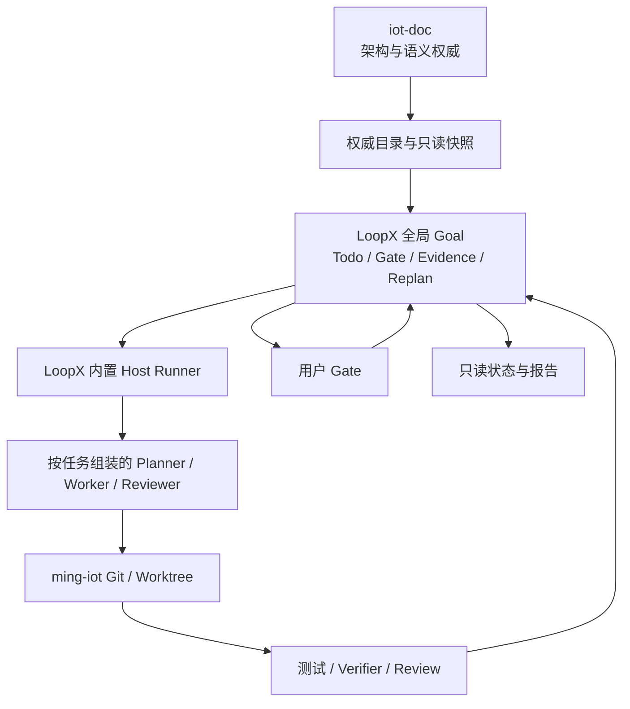
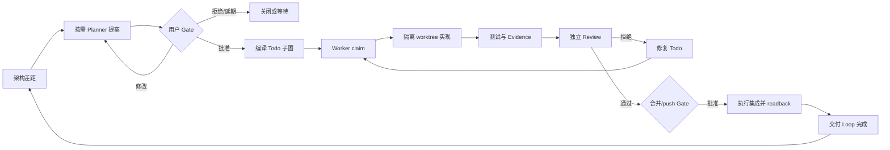
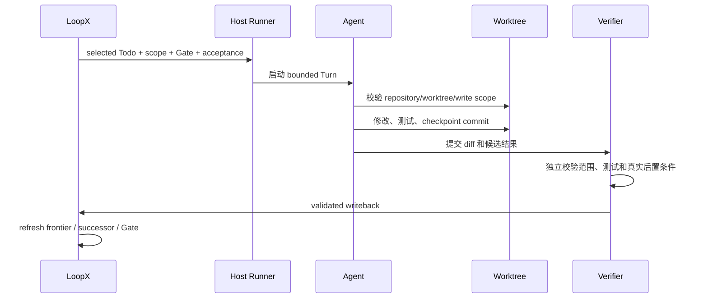

# LoopX 驱动的个人研发框架第一阶段试点设计

> 日期：2026-08-21
>
> 状态：设计已通过，等待实施
>
> 范围：在 Linux/WSL2 上使用官方 LoopX、Codex 和项目级 Harness，完成 `ming-iot` 的第一个真实交付 Loop，验证一套可在公司推广的个人研发框架。本规格不建设公司级协同平台，不集成 Multica，也不自研通用 Agent Runner。
>
> 上位蓝图：[AI Native 软件研发两阶段总蓝图](./2026-08-23-ai-native-software-rd-two-stage-blueprint-design.md)

## 1. 背景与目标

当前工作区包含两类核心资产：

- `iot-doc` 保存工业物联网平台的完整技术架构，当前约完成 70% 的设计讨论；
- `ming-iot` 是后续实现载体，已有 Things 迁移基线、`thingsbaseline` 校验器和自研 `.graph` 控制面。

现有 `.graph` 已经证明机器 Registry、Gate、Evidence、Review 和可视化可以把研发过程外置，但也暴露出三个问题：

1. Todo、Gate、Evidence、Review、新鲜度和恢复逻辑逐渐形成一套自研长程 Agent 内核；
2. 每次开发都需要理解项目专属 Graph 规则，团队使用和模型迁移成本持续上升；
3. 如果再在 LoopX 外保留完整 `.graph` 生命周期，LoopX 只会变成命令包装器，无法发挥其 Goal、Todo、Gate、claim、lease、Evidence、quota、scheduler、handoff 和 replan 能力。

本设计服务于一个稳定的长期业务目标：

```text
按 iot-doc 的架构与语义，实现完整、可验证、可持续演进的工业物联网平台 ming-iot。
```

该目标跨越多个开发会话、多个 Agent 和多个交付阶段。但本规格只验收第一阶段的个人研发闭环，不承诺一次完成整个物联网平台，也不提前建设第二阶段的团队管理平台。

第一阶段要回答的核心问题是：一个开发者能否借助官方 LoopX 和专业 Coding Agent，在不依赖聊天记忆的前提下，持续完成“选定任务、实现、验证、独立复核、人工批准、证据归档”的真实交付。

LoopX 是本阶段唯一动态研发控制面；`iot-doc` 继续拥有架构语义，Git 继续拥有代码事实，确定性校验和独立 Review 提供证明，用户保留架构、范围、合并、push 和敏感操作的最终决定权。

## 2. 方案选择

### 2.1 采用方案

采用“静态工程 Harness + 官方 LoopX 动态控制面 + Codex 执行面 + `ming-iot` 薄项目适配层”：

- 使用官方发布版并锁定经过验证的版本；首期候选基线为 LoopX `v0.5.1`；
- 不 fork LoopX，不把工业物联网领域逻辑写入 LoopX 内核；
- LoopX 拥有全部动态 Goal/Todo/Gate/Evidence/claim/lease/quota/replan 状态；
- `AGENTS.md`、Rules、Skills、MCP 安全策略和验证命令提供模型无关的静态工程约束；
- Codex 是首个通过资格验证的 Coding Agent，负责受限范围内的推理、改码和命令执行；
- 项目适配层只提供架构材料、仓库观察、验证命令和有界结果归一化；
- 先使用 LoopX 内置 visible multi-agent Runner，按需资格验证内置 Headless Turn；
- 只有官方 Runner 真实试运行后仍存在明确缺口，才补充最小 Host glue，并优先向上游贡献通用修复。

### 2.2 未采用方案

| 方案 | 不采用原因 |
| --- | --- |
| fork LoopX 并深度嵌入 IoT 工作流 | 会形成需要长期跟踪上游的第二个产品，升级和安全修复成本过高 |
| `.graph` 与 LoopX 双控制面并行 | 同一 Todo、Gate、Evidence 和完成状态会出现双写与冲突，无法确定唯一事实源 |
| 第一阶段自研完整 `ming-agent-runner` | LoopX 已内置 visible multi-agent Runner、自动唤醒和 Headless `turn run-once`，提前重写属于重复建设 |
| 第一阶段建设 `company-dev` 包装命令 | 会在尚未完成真实试点前冻结错误抽象；缺口优先提交 LoopX 上游，其次使用 Extension |
| 第一阶段引入 Multica 或 DeerFlow | 会同时引入第二套任务编排和状态所有权，无法判断 LoopX 试点本身是否成立 |
| 一次性把全部架构转换成机器 DSL | 成本高、易冻结尚未成熟的设计；首期只建立权威目录、引用和 digest |

### 2.3 LoopX 能力核验基线

本设计已按官方 `v0.5.1` 源码和确定性 smoke 核验以下表面，不再假设项目必须自写 Runner：

- [`loopx multi-agent launch`](https://github.com/huangruiteng/loopx/blob/v0.5.1/docs/guides/multi-agent-product-recipe.md) 可以启动可见 tmux/Codex 多 Agent lane，并提供 state-aware `auto-wake`；
- [`loopx turn run-once`](https://github.com/huangruiteng/loopx/blob/v0.5.1/docs/product/runtimes/codex-cli/loopx-turn-codex-cli-quickstart.md) 内置 Codex CLI adapter，可以执行一个独立验证和幂等写回的 Headless Turn；
- [Custom Agent Runner Integration](https://github.com/huangruiteng/loopx/blob/v0.5.1/docs/guides/custom-agent-runner-integration.md) 明确外层 recurring host仍需应用 scheduler hint，并避免与活动 Turn重叠。

源码存在不等于生产成熟。visible multi-agent是首期默认资格验证路径；Headless Turn仍按官方 `experimental` 边界管理，scheduled continuation属于后续验证项。

## 3. 权威边界

### 3.1 权威关系

| 层 | 唯一拥有的事实 | 不拥有 |
| --- | --- | --- |
| `iot-doc` | 平台应如何设计、术语和业务语义、模块边界与约束 | 当前谁在执行、Todo 状态、代码是否通过 |
| `AGENTS.md` / Rules | 当前仓库强制遵守的工程边界、权限和机械规则 | 动态任务状态、通用方法教程 |
| Skills | 可复用的工作方法、检查清单和领域知识 | 最终授权、不可绕过的机器门禁 |
| LoopX | Goal、Todo、Gate、claim、lease、quota、Evidence lineage、恢复与 replan | 架构语义、模型推理、Git 真实内容 |
| Coding Agent | 当前 Turn 内的推理、改码、测试和结构化回写 | 长期项目事实、批准权、完成状态 |
| Git | 当前代码、分支、提交、worktree 和远端 revision | 业务验收和用户授权 |
| Verifier/Review | 指定 revision 是否满足指定验收 | 任务优先级、架构方向和合并授权 |
| 用户 Gate | 架构变更、交付 Loop 边界、敏感能力、合并与 push 决定 | 普通 Todo 的逐步人工调度 |
| Dashboard/报告 | 对上述事实的只读投影 | 任何写入和批准权 |



### 3.2 架构文档分类

`iot-doc` 同时包含主规格、入门解释、竞品调研、计划和历史材料。首期建立一个很薄的权威文档目录，将材料分为：

- `normative`：实现必须遵守的规格；
- `guide`：帮助理解，不单独形成机器约束；
- `research`：竞品和技术调研，只作为决策输入；
- `historical`：历史方案和已被替代计划，不参与新 Loop 推导。

权威目录只解决“哪些材料约束实现”，不保存研发进度。运行时 `architecture_snapshot_v1` 记录：

- `iot-doc` repository identity 与 Git revision；
- 权威材料路径、角色和内容 digest；
- `ming-iot` 当前 revision；
- 已验证实现与待覆盖架构差距的有界引用。

快照是可再生的 LoopX Material，不复制第二份架构正文，也不成为新的架构权威。

## 4. 全局 Goal 与交付 Loop

### 4.1 单一长期 Goal

项目建立一个稳定的 LoopX Goal，例如：

```text
goal_id: ming-iot-framework-v1
objective: 按 iot-doc 架构实现完整的工业物联网平台
```

该 Goal 在整个平台完成前保持活动。不同 Host、模型和会话通过精确 `goal_id` 连接，不根据目标文字相似度创建重复 Goal。

### 4.2 交付 Loop 的表达

Kafka 基础、物模型、Reducer、Scene Runtime 等“交付 Loop”不是 LoopX 外的第二种生命周期对象，而是同一 Goal 内具有共同 `delivery_loop_id`、边界和阶段验收的 Todo 子图。

一个交付 Loop 至少包含：

```text
交付边界与验收
  ├── 架构一致性检查
  ├── 实现 Todo
  ├── 单元/契约/集成验证 Todo
  ├── 独立 Review Todo
  └── 合并与 push 用户 Gate
```

Dashboard 显示的 `PROPOSED`、`RUNNING`、`VERIFYING`、`WAITING_USER` 和 `DONE` 必须从 LoopX Todo、Gate、Evidence 和 acceptance gap 推导，不能写入另一套可变状态字段。

### 4.3 交付 Loop 提案

按需 Planner 产生的提案至少包含：

```yaml
deliveryLoopId: L2-kafka-foundation
objective: 建立 Things 服务使用的 Kafka 消息基础
authorityRefs: []
dependencies: []
writeScopes: []
nonGoals: []
acceptance: []
risks: []
proposedAgentLanes: []
```

提案作为 LoopX Material 保存并创建用户 Gate。批准前不得创建实现 Todo、启动 Worker、创建写 worktree 或授予代码写权限。

## 5. Loop 发现、批准和执行状态流

### 5.1 发现触发器

Planner 不是常驻“总管 Agent”，也不高于其他 Agent。只有以下事件需要分析和重排时，LoopX 才为当前 Todo 选择或创建一个 `peer_v1` Planner lane：

- 一个交付 Loop 完成；
- 用户提出新目标或缺陷；
- 被引用的 `normative` 架构材料变化；
- 当前任务阻塞、写入范围冲突或 Evidence 过期；
- Todo frontier 无法继续推进，需要 replan。

Planner 对比架构快照、当前代码和已验证 Evidence，最多提出三个候选交付 Loop。排序原则依次为：依赖满足、位于关键路径、降低后续返工、可以独立验收、与活动写入范围不冲突。Planner 只能提出方案，不能批准自己的方案，也不能直接获得代码写权限。

### 5.2 用户批准

用户可以批准、修改、拒绝或延期提案。批准绑定：

- 提案内容和 digest；
- 对应的权威材料 revision/digest；
- repository 与 `writeScopes`；
- acceptance、non-goals 和受限能力。

批准一个交付 Loop同时授权其 Worker在有效边界内自动修改、测试、修复和创建 checkpoint commit，但不授权：

- 修改架构语义；
- 扩大 `writeScopes`；
- 改变验收或 non-goals；
- 使用生产凭据或操作生产环境；
- 合并目标分支或执行 push。

### 5.3 Todo 图编译与闭环



在批准边界内，Todo 拆分、排序和等价 successor 可以自动 replan。任何会扩大边界、改变架构或改变 acceptance 的 replan 都必须重新进入用户 Gate。

## 6. Agent 与 Runner 模型

### 6.1 Actor 边界

所有模型 Agent 都使用同一等级的 `peer_v1` 身份，角色是当前 Todo 授予的临时职责，不形成永久 Leader 或 Supervisor。

| Actor / role | 创建与唤醒 | 权限 |
| --- | --- | --- |
| LoopX Control Plane | 项目持久状态 | 计算 frontier、Gate、claim、lease、quota 和恢复，不执行模型推理 |
| Planner role | 复杂任务、跨模块任务或需要 replan 时按需组装 | 只读分析并提出 Todo 图、边界或 replan；不批准、不改代码 |
| Worker role | 获批 Todo 可执行后按 lane 注册 | 仅在 Todo 的 repository、worktree 和 `writeScopes` 内实现和验证 |
| Reviewer role | 需要独立复核时使用不同 Agent 身份 | 只读 diff、重跑验证并提交 Review；默认不修代码 |
| Host Runner | LoopX 内置 visible/headless 执行面 | 启动、唤醒和停止模型进程，不拥有 Todo 和授权事实 |

角色拓扑按风险自适应：

| 任务等级 | 默认角色拓扑 | 适用条件 |
| --- | --- | --- |
| 简单 | Worker + 机器门禁 | 小范围、可逆、验收完全确定、无敏感接口 |
| 普通 | Worker + 独立 Reviewer + 机器门禁 | 一般功能、缺陷修复、需要独立检查的代码修改 |
| 复杂/高风险 | Planner + Worker + 独立 Reviewer + 机器门禁 + 额外架构/范围 Gate | 跨模块、架构语义变化、权限/数据迁移、难以回滚或影响公共接口 |

任务等级由显式风险规则和 Todo 边界推导，Agent 不能为了跳过 Review 自行降级。所有等级的 merge、push 和敏感外部副作用仍需用户 Gate；表中的额外 Gate 指复杂任务在进入实现前还要单独确认架构和范围。Agent identity 与模型品牌分离；首期只将 Codex 作为已支持执行面，其他 Coding Agent 必须通过相同的角色、权限、恢复和验证资格测试后才能接入。新会话默认使用 fresh identity，除非通过精确 takeover/handoff 接管既有 Agent。

### 6.2 第一执行面：内置 visible multi-agent Runner

首期优先使用 LoopX 已发布的通用可见 Runner：

```bash
loopx multi-agent launch \
  --spec <approved-role-spec.json> \
  --workspace <control-workspace> \
  --execute \
  --auto-wake \
  --attach
```

它负责：

- 创建 tmux session 和每个角色的真实 Codex TUI pane；
- 提供 attach、stop、wake 和可见人工接管；
- 后台读取 Todo readiness；
- 仅在 readiness edge 或有界重试时向目标 pane 发送固定唤醒提示。

`auto-wake` 是独立后台进程，不是永久线程。它不选择 Todo、不写 LoopX 状态、不消耗 quota，也不读取 transcript 或凭据。每个 pane 必须重新读取 LoopX 当前决策并自行通过 Gate、claim、workspace 和 validation guard。

其内部可以轻量轮询 Todo readiness，但只有 readiness edge或有界重试才唤醒模型；无可运行 Todo时不发起 Agent Turn、不消耗 token。因此“事件驱动”约束的是模型执行和状态变化，不要求底层唤醒传输必须完全没有轮询。

### 6.3 第二执行面：内置 Headless Turn

LoopX `v0.5.1` 提供实验性的 `isolated-headless`：

```bash
loopx turn run-once \
  --goal-id <goal-id> \
  --agent-id <agent-id> \
  --host codex-cli \
  --execution-mode isolated-headless \
  --project <isolated-worktree> \
  --validation-command-json '["./verify-postcondition"]' \
  --execute
```

内置 Codex adapter 可以完成一次“新鲜决策、模型执行、独立验证、写回、quota spend 和 scheduler 检查”，无需项目自写模型 adapter。首期只做独立资格验证，不把该实验路径作为默认持续执行面，也不得与 visible Runner 对同一逻辑 Turn 双重调度。

### 6.4 不预设自研 Runner

源码已经提供：

- visible multi-agent Runner 与 state-aware `auto-wake`；
- Headless `turn run-once`；
- scheduler-hint-aware external worker 参考实现。

因此第二阶段不是“必然开发 `ming-agent-runner`”，而是先评估以下运维缺口：

- WSL/ECS 重启后的 session 恢复；
- 动态 lane 与 worktree 分配；
- systemd 托管、日志和资源上限；
- recurring Headless Turn 的不重叠保证；
- 项目专用 verifier 的发现和绑定。

只有真实试运行证明现有表面不能满足某个明确合同，才增加薄 Host glue；不得复制 LoopX Todo/Gate/Evidence/scheduler 状态机。

### 6.5 Codex Chat 生命周期与上下文预算

必须区分三类上下文：

| 上下文 | 用途 | 权威性与生命周期 |
| --- | --- | --- |
| Codex Chat | 保存当前模型推理、刚读取的代码和短期执行计划 | Host 拥有的临时工作记忆，不是项目事实源 |
| LoopX canonical state | 保存 Goal、Todo、Gate、claim、Evidence 和恢复关系 | 跨 Chat、进程和模型持久存在 |
| `TurnEnvelope` | 将本轮 selected Todo、边界、Gate、验收和紧凑引用交给 Agent | 每轮重新生成，JSON 预算为 8 KiB；其 compaction 不会压缩已经存在的 Codex Chat |

LoopX `v0.5.1` 的内置执行面具有以下真实边界：

- visible multi-agent Runner 会等待 lane 对应的 Codex TUI pane 可输入，再向同一个 pane 发送唤醒提示；只要 TUI 未退出，同一 lane 的多个 Turn 通常继续使用同一个 Chat；
- visible Runner 不读取 transcript、隐藏 session 文件或可靠的上下文 token 计数，也不按 Chat 长度自动轮换；Codex 自身的上下文 compaction 属于 Host/模型能力，不是 LoopX 项目状态管理；
- Headless `turn run-once` 将不透明 resume id 保存在本地，并按 `(goal_id, agent_id, todo_id)` 绑定；相同绑定且 session 仍合格时可以 resume，Todo 或 Agent 改变、session 丢失或合同不兼容时必须新建；
- 自适应子 Agent 的默认 `context_policy` 是 `fresh`，只有 Host 声明 resume 能力且协调者选择后才允许复用。

上述边界来自 LoopX `v0.5.1` 的 [`visible_multi_agent_tmux.py`](https://github.com/huangruiteng/loopx/blob/v0.5.1/loopx/visible_multi_agent_tmux.py)、[`codex_cli.py`](https://github.com/huangruiteng/loopx/blob/v0.5.1/loopx/control_plane/turn_driver/codex_cli.py)、[`turn_envelope.py`](https://github.com/huangruiteng/loopx/blob/v0.5.1/loopx/control_plane/quota/turn_envelope.py) 和 [`task_orchestration_admission.py`](https://github.com/huangruiteng/loopx/blob/v0.5.1/loopx/control_plane/quota/task_orchestration_admission.py)。Codex/模型侧 compaction 的能力边界以 [OpenAI 官方文档](https://developers.openai.com/api/docs/guides/latest-model?model=gpt-5.2) 为准。

`ming-iot` 采用“Todo 内复用、边界处换新”的 Chat 策略：

| 决策 | 条件 |
| --- | --- |
| 可以复用 | 同一 Todo、同一 Agent 职责、相同 authority/acceptance/write scope，且只是连续实现、验证或有界修复 |
| 必须换新 | Todo 完成并进入 successor、Worker 转 Reviewer、Agent 职责变化、authority/acceptance/write scope 实质变化、旧 Chat 不可恢复或合同不兼容 |
| 应当换新 | 连续两个合格 Turn 没有 outcome progress、上下文明显污染或重复探索；先产生 repair/replan 与紧凑 handoff，再启动 fresh Chat |

Chat 切换前必须先建立可恢复检查点：

```text
验证并 checkpoint 当前 Git 状态
  -> 写回 Todo、Evidence、未解决 blocker 和 successor/replan
  -> 记录当前 revision、scope、acceptance 与验证结果引用
  -> 关闭或停止向旧 Chat 分配新工作
  -> fresh Chat 重新读取 TurnEnvelope、Git 与外部事实
```

handoff 只传递结构化状态和引用，禁止复制完整 transcript。若同一职责继续执行，可以通过精确 reattach/takeover 保留原 `agent_id`；职责或审查主体变化时必须注册 fresh identity。

第一阶段不实现读取 transcript 或隐藏 Codex session 来计算上下文，也不承诺一个未经测量的固定 token 阈值。visible 试点以一个 Todo 或显式声明的紧耦合 Todo bundle 为 Chat 边界，在边界结束后停止旧 lane/session 并用内置 launcher 启动 fresh Chat；只有真实测量证明需要自动轮换时，才提出不读取 transcript 的公共安全 Host 指标与薄 glue。

## 7. 一轮 Agent 执行协议



Validated writeback 至少包含：

- 实际修改文件和 Git revision；
- 执行的验证命令及结果引用；
- Evidence 与 Review 引用；
- 未解决问题；
- successor、replan 或结构化 `no-follow-up`。

进程退出码、Agent 完成声明和聊天文本都不能单独证明 Todo 完成。Agent之间通过有界状态和 Evidence handoff，不复制完整 transcript。

## 8. 仓库、工作区与并发

### 8.1 仓库权限

| Repository | 默认权限 |
| --- | --- |
| `iot-doc` | 架构权威，默认只读；修改必须通过 architecture Gate |
| `ming-iot` | 交付 Loop批准后在声明范围内可写 |
| `things` | 联犀官方外部仓库，永久只读 |
| 其他参考仓库 | 默认只读，不纳入自动提交和 push |

repository 通过不含凭据的 identity 和本地 workspace mapping 解析，不能把某台机器的绝对路径写入公共协议或 Evidence。

### 8.2 Worktree 与并发

首期最多允许三个活动交付 Loop，同时全局最多三个有写权限的 Worker运行。并发必须满足：

- 前置依赖已完成；
- `writeScopes` 可证明不重叠；
- 公共接口没有未解决的并发变更；
- 每个 Worker 使用独立 Git worktree；
- 每个 Todo同一时间只被一个 Agent claim；
- 当前主机资源预算允许。

LoopX visible multi-agent Runner允许多个只读 lane共享控制 workspace，但任何 mutating Todo都必须在执行前绑定独立 worktree。不能把共享 TUI workspace误当成并发写隔离。

Reviewer不能使用实现者的 `agent_id`。Review失败只产生 findings 和修复 Todo；Reviewer默认不直接修改被审代码。

## 9. 失败、恢复与重试

### 9.1 失败分类

| 失败 | 恢复策略 |
| --- | --- |
| 确定性测试失败 | 不盲目重复，生成修复 Todo |
| 网络或模型服务暂时不可用 | 有界退避重试，不为无进展轮次 spend quota |
| Agent、Host 或 WSL 中断 | 保留 worktree，lease 到期后重新计算 frontier并接管 |
| push/发布结果未知 | 先 readback 外部状态，禁止直接重复副作用 |
| 越出批准范围 | fail closed，创建用户 Gate |
| LoopX projection 不一致 | 从 canonical event/state 重建，不手工修展示结果 |
| 用户尚未批准 | 合法等待，不视为失败，不持续唤醒模型 |

### 9.2 重启恢复

恢复顺序固定为：

```text
读取 LoopX canonical state
  -> 检查 Git revision 与 worktree
  -> 检查 claim/lease
  -> 重算 Gate、capability、scope 与 frontier
  -> 继续、接管、隔离或 replan
```

脏 worktree不能自动删除：

- 有 checkpoint commit：可由新 Worker按 handoff继续；
- 有未提交改动：创建 `recovery_required` Todo；
- 修改越界或来源不明：隔离并等待用户决定。

### 9.3 外部副作用

push、发布和生产操作必须绑定稳定 `effect_id`。超时后状态进入 `UNKNOWN`，先查询远端 revision或效果 readback；只有确认未发生且重试安全后才能重放。

## 10. Evidence 新鲜度

Evidence绑定：

- 被验证的 Git revision；
- 对应 `authorityRefs` 和 digest；
- acceptance/verifier版本；
- 实际覆盖的文件、接口和作用域。

失效必须精确传播：

- 无关文件变化不影响既有 Evidence；
- 实现变化只重跑相关测试和 Review；
- 被引用的 `normative` 文档变化暂停受影响 Todo并触发 replan；
- `guide`、`research` 和 `historical` 变化不使实现 Evidence失效；
- verifier变化只使其覆盖的证明失效。

已完成的交付 Loop保持历史完成状态。后续接口变化创建新的兼容性验证或修复 successor，不能把历史改写成“从未完成”。

## 11. 静态 Harness 试点合同

LoopX 负责“当前做什么、由谁做、做到哪一步”，静态 Harness 负责“无论谁来做都必须遵守什么”。二者必须分层，不能把所有工程知识塞进 LoopX Todo，也不能依赖某个 Chat 记住规则。

### 11.1 资产分工

| 资产 | 作用 | 约束 |
| --- | --- | --- |
| `AGENTS.md` | 面向所有 Agent 的短入口和权威索引 | 保持精简，引用详细 Rules/Skills，不复制百科全书 |
| Rules | 强制工程规则、目录边界、权限和失败策略 | 尽可能由脚本、schema、测试或 hook 机械校验 |
| Skills | 可复用的方法、步骤、检查清单和领域指导 | 提供工作方法，不替代 Gate 或机器校验 |
| MCP policy | 外部工具、凭据、网络和环境能力的准入规则 | 默认只读、最小凭据；生产写入必须等待用户 Gate |
| Verifiers | 对指定 revision 和验收条件给出可重复证明 | 输出命令、版本、结果和 Artifact 引用 |

第一阶段不开发 `company-dev init/status/upgrade/doctor` 等包装命令。安装、诊断和升级直接使用 LoopX 官方命令；发现通用缺口时优先提交上游，其次使用 LoopX Extension，只有无法兼容时才评估 fork。

### 11.2 确定性检查与 AI 审计分离

- `check` 是确定性过程：相同 revision、工具版本和输入必须得到相同 PASS/FAIL，可进入机器门禁；
- `audit` 是 AI 辅助判断：用于发现风险、解释差异和提出改进，只形成 findings，不以模型评分直接阻断交付；
- AI 的“看起来没问题”和一次成功命令都不能替代 Evidence；
- 团队共享 Rules/Skills 的改进必须经过版本化 diff 和用户批准，禁止自动复制、静默同步或覆盖本地规则。

### 11.3 四层验证

| 层级 | 内容 | 常见执行时机 |
| --- | --- | --- |
| L1 基础质量 | format、build、lint、静态检查 | Worker 修改期间快速反馈 |
| L2 行为证明 | unit、contract、integration、race 等与变更相关的测试 | Todo 验收前 |
| L3 项目规则 | 目录边界、依赖方向、生成物、凭据、scope 和仓库结构约束 | pre-review / pre-merge |
| L4 架构与交付语义 | `iot-doc` 规范、跨模块语义、non-goals 和交付 acceptance | 独立 Review 与用户 Gate |

简单任务可以省略独立 Reviewer，但不能跳过适用的机器层级。复杂任务即使 L1/L2 全绿，也必须完成 L3/L4 和独立 Review。

## 12. 从 `.graph` 到 LoopX 的切换

### 12.1 历史处理

现有 G0、L0和对应 Evidence/Review保留原样，不迁移、不重写。它们作为历史记录继续可读，但不参与新 Todo、Gate和完成状态。

### 12.2 一次性 Bootstrap

LoopX接管前由现行 AGENTS、旧 Graph和用户批准约束一次性迁移：

1. 安装并锁定官方 LoopX发布版，安装同版本 workflow skills；
2. 执行 `loopx doctor`；
3. 连接 `ming-iot`，创建精确全局 Goal；
4. 注册 `peer_v1` 角色合同和首期 Planner/Worker/Reviewer lane；
5. 建立 `iot-doc` 权威目录和只读快照；
6. dry-run visible multi-agent角色规格；
7. 原子更新 AGENTS、Git Hook、ignore和控制面说明；
8. 用户批准 cutover；
9. 从下一真实交付 Loop开始只写 LoopX。

Bootstrap是一次迁移检查点，不新增 `.graph/loops/*.yaml`，也不要求先为“替换 Graph”扩展旧 Graph。

### 12.3 切换后的规则

切换提交完成后：

- LoopX成为新工作的唯一动态事实源；
- `.graph` 只读冻结，不再新增或更新 Loop生命周期；
- `graphctl` 中可复用的编译、契约和 scope校验降级为普通 verifier；
- 旧 pre-push生命周期编排退出，不与 LoopX再做一次 owner/Gate/完成判断；
- 不设置一个常态耗时数分钟的全局 pre-push门禁；
- push仍必须先有用户 Gate和新鲜 premerge Evidence；
- Dashboard只能读取 LoopX投影或展示历史，不获得写权限。

Root和 `ming-iot/AGENTS.md` 必须明确：用户批准交付 Loop即授权其范围内的 checkpoint commit；合并和 push仍需要单独明确授权。

### 12.4 回退

cutover前保留旧 AGENTS、Hook和 Graph revision。若 LoopX接入验收失败：

- 停止创建新 LoopX Todo；
- 保留 `.loopx` 私有状态用于诊断，不提交到 Git；
- 通过用户批准的回退提交恢复旧协作规则；
- 不删除 G0/L0历史和任何未知 worktree；
- 修复后重新执行完整 cutover验收，禁止临时双写。

## 13. 第一阶段交付物

第一阶段采用“真实交付优先”，不先制作脱离项目的通用模板。交付顺序固定为：建立最小可运行控制面，选择一个真实 `ming-iot` 需求跑完整闭环，再从实际 Evidence 中提炼可复用资产。

本阶段交付：

1. LoopX版本锁、安装和回滚说明；
2. 同版本 workflow skills与 `doctor` readback；
3. `ming-iot-framework-v1` 全局 Goal；
4. `peer_v1` 与按风险组装的 Planner/Worker/Reviewer 角色合同；
5. `iot-doc` 权威目录与 `architecture_snapshot_v1`；
6. 最小项目适配层，只读读取架构、Git和 verifier结果；
7. 交付 Loop提案、批准和 write-scope协议；
8. visible multi-agent Runner dry-run与真实可见启动；
9. AGENTS、Hook和 `.graph` 冻结切换；
10. Codex Chat 生命周期、紧凑 handoff 和 fresh Chat 恢复演练；
11. 一个模拟闭环和一个真实交付 Loop闭环；
12. 四层验证、确定性 `check` 与 AI `audit` 的试点合同；
13. 一次完整 Closeout，以及由真实问题驱动的 Rules/Skills 改进提案；
14. 运维、失败恢复和回退说明。

项目内版本化配置建议集中在 `ming-iot/automation/loopx/`，运行时 `.loopx/`、`.codex/goals/`、`.local/` 和 session产物必须忽略，不提交到 Git。

## 14. 非目标

第一阶段不包含：

- 完整物联网平台实现；
- 公司级项目管理、派单、RBAC、里程碑和交付平台；
- Multica、DeerFlow、LangGraph 或 A2A 集成；
- 在真实 `ming-iot` 交付前制作通用团队模板；
- 自研 `company-dev` 命令行或 LoopX 功能复制层；
- 自研通用 `ming-agent-runner`；
- 把 Headless `turn run-once` 提升为默认生产执行面；
- G0/L0历史迁移；
- fork或修改 LoopX内核；
- 跨机器共享 authoritative state；
- 新的复杂 Dashboard；
- 把全部 Markdown转换成机器 DSL；
- 读取 transcript 或隐藏 Codex session 来估算上下文、实现按 token 自动轮换；
- 自动使用生产凭据、自动部署生产或自动 push；
- 同时启动三个未经真实资格验证的业务 Loop。

## 15. 验证策略

### 15.1 确定性验证

- LoopX版本、workflow skill版本和 `doctor` 一致；
- 权威目录分类、引用解析和 digest稳定；
- 未批准提案不能产生实现 Todo或写权限；
- write scope、repository identity和 worktree guard fail closed；
- Reviewer身份与实现者不同；
- `TurnEnvelope` 不超过 8 KiB，且 fresh Chat 不依赖 transcript 即可恢复 selected Todo；
- 无关改动不触发全局 Evidence失效；
- LoopX状态可以在新会话中按精确 Goal恢复；
- 新交付 Loop不会写入 `.graph`；
- `AGENTS.md` 只作入口，Rules、Skills、MCP policy 和 verifier 引用均可解析；
- `check` 结果可重复，AI `audit` findings 不冒充机器 PASS；
- 简单、普通、复杂任务能按显式风险规则选择不同角色拓扑。

### 15.2 Runner资格验证

首期必须先运行 LoopX官方 deterministic smokes，再做项目内 dry-run：

- visible multi-agent launcher；
- state-aware auto-wake；
- generic one-command multi-agent；
- Headless Turn fake-host幂等 replay。

真实模型资格验证分开执行：visible Runner是默认试点；Headless `run-once` 只有在明确模型、sandbox、worktree、timeout和独立 validator后才可运行，结果不能直接外推为持续自动化已成熟。

### 15.3 第一阶段验收

第一阶段只有同时满足以下条件才完成：

1. 官方 LoopX固定版本安装和 `doctor` 通过；
2. 重启 Agent Host后能按精确 `goal_id` 恢复；
3. `normative`、`guide`、`research`、`historical` 不会混淆；
4. 未批准提案不产生实现 Todo、Worker或写权限；
5. 批准后只能修改声明的 repository、worktree和 `writeScopes`；
6. Worker可以在批准范围内创建 checkpoint commit，但不能自动 push；
7. Reviewer使用独立身份并能拒绝不充分 Evidence；
8. Agent或WSL中断后能从 LoopX、Git和 worktree恢复；
9. 新交付 Loop只存在于 LoopX，不与 `.graph` 双写；
10. visible multi-agent Runner可以启动、attach、自动唤醒和安全停止；
11. 同一 Todo 的有界连续 Turn 可以复用 Chat，并至少完成一次不复制 transcript 的 fresh Chat handoff 恢复；
12. Worker 与 Reviewer 使用不同 Chat，旧 Chat 不能替代新鲜 Gate、scope、Git 和 Evidence 读取；
13. 一个真实交付 Loop完成“提案、批准、实现、四层验证、Review、合并 Gate、readback 和 Closeout”闭环；
14. 简单任务可以由 Worker + 机器门禁完成，普通和复杂任务会强制使用独立 Reviewer；
15. 试点产物足以让 fresh Chat 或升级后的 Agent只依赖版本化资产继续工作，而不依赖旧聊天记录。

## 16. Closeout 与经验沉淀

交付完成不等于最后一条测试变绿。每个真实交付 Loop 在关闭前必须执行一次结构化 Closeout，其中 revision、Evidence 和 readback 由确定性检查验证，规则改进和风险接受仍由人决定：

```text
确认目标 revision 与远端 readback
  -> 汇总新鲜 Evidence、Review 和用户批准
  -> 归档关键决策、偏差、失败尝试和剩余风险
  -> 更新架构覆盖关系与后续 Todo
  -> 提出 Rules / Skills / verifier 改进建议
  -> 用户批准后才修改共享标准
  -> 标记交付 Loop 完成
```

Closeout 不复制完整聊天记录，也不把所有日志提交到 Git。它只保存能够重放结论的命令、版本、digest、精简 Artifact 引用和人工决定。编译或测试失败时不自动回滚和删除现场；保留 worktree 与 Evidence，创建 repair Todo。

## 17. 安全与隐私

- LoopX状态只保存有界公共安全信息，不保存原始 transcript、凭据、模型内部日志或大段测试输出；
- Agent可观察到 capability不等于获得用户授权；
- MCP 和其他外部连接默认只读、最小作用域和独立凭据，生产写入、发布及敏感数据访问必须等待用户 Gate；
- `iot-doc` 和参考仓库读取范围由 Goal boundary明确；
- visible Runner必须保留 attach、interrupt和 stop控制；
- Headless Turn不得从可见模式静默降级启动；
- 所有外部 effect必须有 scope、Gate、幂等 identity和 readback；
- 本地 runtime状态进入 Git ignore，版本化政策和角色合同进入代码评审。

## 18. 后续演进

第一阶段完成后，LoopX根据真实证据选择下一项，而不是预先承诺自研 Runner或团队平台：

1. 如果 visible multi-agent已满足开发效率，继续完善角色、worktree和 verifier；
2. 如果需要无人值守单轮执行，资格验证内置 Headless `turn run-once`；
3. 如果需要跨重启 recurring headless，先组合官方 scheduler hint和外部 Worker参考实现；
4. 只有存在无法通过配置或薄 glue解决的通用缺口，才提出上游贡献或最小项目扩展；
5. 每个 IoT业务模块继续以独立交付 Loop获得边界、验收和用户批准。

只有首个真实 Loop 验收后，才把稳定的 AGENTS 索引、Rules、Skills、MCP policy、角色合同和 verifier 提炼成公司个人开发框架候选基线。第二阶段公司级协同平台按上位蓝图另行设计；它不会在本规格内悄悄扩大 LoopX 的事实所有权。

该演进路径确保 LoopX真正承担本地长程控制面，同时让 `ming-iot` 保持领域实现仓库，而不是演变成另一个 Agent编排框架。
