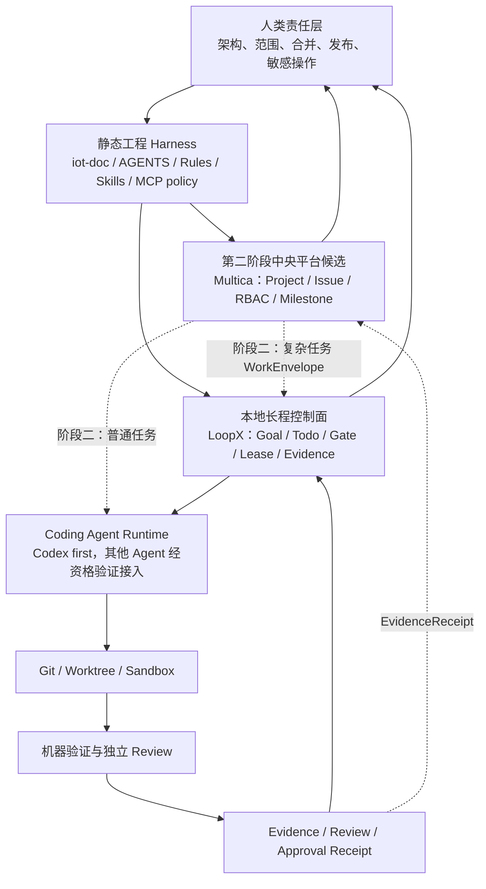

# AI Native 软件研发两阶段总蓝图

> 日期：2026-08-23
>
> 状态：设计已通过，等待分阶段实施
>
> 范围：定义从个人 AI 研发框架到公司级 AI Native 软件交付平台的两阶段演进路线，以及 Harness、LoopX、Coding Agent、机器验证、人工 Gate 和 Multica 候选平台之间的权威边界。

## 1. 目标与核心结论

最终目标不是再造一个会聊天的“大 Agent”，而是建立一套可持续发现错误、修正错误、积累证据并交付软件的研发系统：

```text
阶段一：可在公司推广的个人开发框架
  -> 用 ming-iot 真实交付验证
  -> 沉淀模型无关的工程资产和证据
  -> 阶段二：公司团队协同与项目交付平台
```

采用以下总体结论：

1. 第一阶段使用官方 LoopX 作为本地长程任务控制面，Codex 作为首个 Coding Agent；
2. 静态 Harness 与动态控制面分层：前者定义“必须怎样做”，后者管理“现在做什么、谁来做、做到哪”；
3. 第二阶段采用“确定性中央平台 + Agent 执行 + 机器验证 + 人工负责”的混合架构，不把公司治理交给单个 Agent；
4. Multica 是第二阶段中央平台的优先候选，不是第一阶段依赖，也尚未被选定为生产基座；
5. 第二阶段不会推翻 LoopX。普通任务可由中央平台直接派给 Coding Agent，复杂长任务才下发给一个有边界的 LoopX 执行舱；
6. Chat、模型记忆和模型评分都不是项目事实源，任何实质结论必须落到版本化合同、Git、Evidence 或人工批准中。

## 2. 设计原则

### 2.1 事实只能有一个所有者

同一种状态不得由 LoopX、Multica、Git 和自研 Registry 同时写入：

- Git 拥有代码和 revision；
- `iot-doc` 拥有工业物联网架构语义；
- 第一阶段由 LoopX 拥有本地 Goal/Todo/Gate/Evidence 动态状态；
- 第二阶段由中央平台拥有公司 Project/Issue/assignment/RBAC/milestone/final status；
- Verifier 拥有指定 revision 的客观验证结果；
- 用户或授权责任人拥有架构、范围、合并、发布和敏感操作的最终决定。

### 2.2 Agent 负责判断，程序负责秩序

Agent 擅长需求理解、方案比较、代码实现、缺陷诊断和 Review；确定性程序擅长身份、租约、权限、状态机、幂等、审计、配额和失败恢复。公司研发平台必须组合两者，而不是在“全部写死”与“全部交给 Agent”之间二选一。

### 2.3 证据优先于声明

“Agent 说完成”“命令曾经绿过”和“CI 跑过”都不是充分结论。Evidence 必须绑定代码 revision、规则/规格版本、验证器版本、实际作用域和结果 Artifact。相关输入变化后，旧证明精确失效；无关变化不触发全局重跑。

### 2.4 先真实交付，再抽象平台

第一阶段先用 `ming-iot` 跑通一个真实交付 Loop，再提炼公司资产。不得先建设大而全的 CLI、Dashboard、团队模板或第二套 Runner，以免将未经验证的假设固化成平台。

## 3. 分层架构



### 3.1 各层职责

| 层 | 负责 | 明确不负责 |
| --- | --- | --- |
| 静态工程 Harness | 架构索引、Rules、Skills、MCP 准入、验证入口、安全边界 | 动态 Todo、Agent 调度、项目进度 |
| LoopX | 本地长任务的 Goal/Todo/Gate、claim/lease、quota、handoff、replan、Evidence lineage | 公司组织、全局 RBAC、跨项目最终状态 |
| Coding Agent | 当前受限 Turn 的推理、改码、测试、结构化交接 | 长期事实、批准、自证完成 |
| Verifier / Reviewer | 对指定 revision 提供可重复证明和独立 findings | 任务优先级、架构决策、合并授权 |
| 中央平台 | 公司 Project/Issue、派单、RBAC、里程碑、组合状态、全局证据索引 | 直接复制本地 LoopX 内部状态机 |
| 人类责任层 | 目标、架构、风险接受、敏感能力、合并与交付决定 | 普通 Todo 的逐轮人工调度 |

### 3.2 Harness 的组成

- `AGENTS.md`：短入口和权威索引；
- Rules：必须遵守且尽可能可机械校验的规则；
- Skills：可复用的方法、步骤和领域知识；
- MCP policy：外部服务、网络、凭据和生产能力的准入策略；
- Verifiers：format/build/lint、测试、结构规则和架构语义检查；
- Closeout：将 Evidence、决策、失败与改进建议沉淀为可复用资产。

Harness 不等于一个新编排器。它既约束 LoopX 调起的 Codex，也约束将来由 Multica 直接调起的其他 Coding Agent。

## 4. 第一阶段：个人研发框架

### 4.1 阶段目标

在 Linux/WSL2 环境中，让一个开发者能够使用官方 LoopX 和 Codex，完成 `ming-iot` 的真实长程交付，并在 Agent/Chat/模型升级后继续恢复工作。

详细设计见：[LoopX 驱动的个人研发框架第一阶段试点设计](./2026-08-21-loopx-driven-iot-development-control-plane-design.md)。

### 4.2 技术边界

- 官方 LoopX 是唯一动态控制面；旧 `.graph` 只读冻结；
- Codex-first、visible-first，Headless 只做受控资格验证；
- Agent 使用同级 `peer_v1` 身份，Planner/Worker/Reviewer 是临时职责；
- 简单任务采用 Worker + 机器门禁；普通任务增加独立 Reviewer；复杂任务增加 Planner 和用户 Gate；
- 使用 Git worktree 隔离写入，参考仓库默认只读；
- 不开发 `company-dev` 包装命令，不 fork LoopX，不自研 Runner；
- LoopX 缺口优先上游 PR，其次 Extension，fork 是最后选择；
- 不接入 Multica、DeerFlow、LangGraph 或 A2A。

### 4.3 单个交付闭环

```text
发现真实架构差距或缺陷
  -> 按需 Planner 提案
  -> 用户确认边界与验收
  -> LoopX 编译 Todo / Gate / scope
  -> Worker 在独立 worktree 实现
  -> L1/L2/L3/L4 适用验证
  -> 独立 Reviewer（普通/复杂任务）
  -> 用户批准 merge / push
  -> readback
  -> Closeout 与经验沉淀
```

### 4.4 阶段产物

第一阶段不是只产出代码，还要产出：

- 一套在 `ming-iot` 验证过的 AGENTS 索引、Rules、Skills 和 MCP policy；
- LoopX 角色、scope、handoff、恢复和 Evidence 合同；
- 四层验证器及确定性 `check` / AI `audit` 边界；
- 一个真实交付 Loop 的完整 Evidence；
- Agent 中断、Chat 切换、WSL 重启和失败修复的恢复证据；
- 基于真实摩擦提炼的公司个人开发框架候选基线。

### 4.5 阶段退出条件

只有满足以下条件，才开始第二阶段平台化：

1. 至少一个真实 `ming-iot` 交付 Loop 完整闭环，而不是只跑示例；
2. fresh Chat 不依赖旧 transcript 即可继续任务；
3. Agent 越界、Evidence 过期、Review 缺失和未批准 push 能被可靠发现；
4. 日常快速验证不会让开发者常态等待数分钟；完整验证按风险和变更影响执行；
5. 至少一次失败和恢复被证明，而不是只验证 happy path；
6. 能明确列出哪些资产可复用、哪些仍是 `ming-iot` 专属；
7. 团队试用者不需要理解 LoopX 内部实现才能完成基本操作。

## 5. 第二阶段：公司级协同与交付平台

### 5.1 阶段目标

将个人闭环扩展为公司级项目管理、需求拆解、派单、并行协作、测试、里程碑、审批和交付平台，同时保留专业 Coding Agent 的代码能力与 LoopX 的长程执行能力。

Multica 是当前中央平台优先候选，因为它面向多 Agent 团队、任务协作和持久化控制面。但第二阶段启动前仍需完成源码、安全、许可、可观测性、数据模型、HA 和组织接入资格评估。

### 5.2 中央平台的唯一事实

第二阶段由中央平台唯一拥有：

- Organization / Project / Milestone；
- Issue、父子依赖、优先级和最终状态；
- 人员与 Agent 身份、RBAC、派单和租约；
- 跨仓库/跨团队审批；
- 全局 Evidence 索引和交付报告；
- 成本、SLA、审计和运营指标。

LoopX 不再拥有公司级 Project/Issue 的最终状态，只拥有一次复杂任务执行舱内部的 Todo/Gate/lease/Evidence 细节。

### 5.3 执行路由

| 任务类型 | 默认执行路径 |
| --- | --- |
| 短小、单仓库、验收确定 | 中央平台直接创建隔离环境并调用合格 Coding Agent |
| 普通功能或缺陷 | Coding Agent + 独立 Reviewer + 机器验证 |
| 跨会话、跨多个 Todo、需要恢复/replan 的长任务 | 中央平台创建 WorkEnvelope，委托一个有界 LoopX 执行舱 |
| 大量研究、方案比较 | 可调用只读研究 Agent；结论必须进入版本化决策或 Evidence |
| 架构、生产、敏感数据和难回滚任务 | 强制人工 Gate，不因 Agent 数量增加而放宽权限 |

任务不能同时由中央平台和 LoopX 独立拆解成两套相互竞争的最终状态。中央平台选择执行路径，LoopX 只在已授予的 Envelope 内自主 replan。

### 5.4 平台与 LoopX 的最小合同

中央平台下发版本化 `WorkEnvelope`，概念字段如下：

```yaml
schema: work_envelope_v1
taskId: company-issue-123
taskVersion: 7
leaseId: lease-456
repositoryRefs: []
baseRevisions: {}
authorityRefs: []
writeScopes: []
acceptance: []
nonGoals: []
requiredGates: []
deadline: null
```

LoopX 执行舱只返回 `EvidenceReceipt`，不直接宣布公司 Issue 完成：

```yaml
schema: evidence_receipt_v1
taskId: company-issue-123
taskVersion: 7
leaseId: lease-456
result: pass | fail | blocked | unknown
candidateRevisions: {}
evidenceRefs: []
reviewRefs: []
remainingRisks: []
requestedFollowups: []
```

中央平台验证 task/version/lease、读取 Git 和 Evidence，并在自己的 Gate 规则下决定 Issue 的下一状态。合同不传递原始 transcript，也不把凭据放入 Envelope。

## 6. 从第一阶段到第二阶段的复用

第二阶段替换的是“单人本地管理范围”，不是第一阶段的工程事实和执行协议。

| 第一阶段资产 | 第二阶段去向 |
| --- | --- |
| `iot-doc`、AGENTS、Rules、Skills | 继续作为版本化工程 Harness，由中央平台分发和索引 |
| Verifier 与四层门禁 | 进入公司验证服务或 CI Runner，语义保持一致 |
| Agent 角色和资格测试 | 扩展为公司 Agent Catalog 与 capability policy |
| scope、Gate、Evidence、handoff 合同 | 成为 WorkEnvelope/EvidenceReceipt 的基础 |
| LoopX 本地 Goal/Todo | 复杂 Issue 内部执行状态，不提升为公司全局状态 |
| Git worktree 和 sandbox 经验 | 扩展为按任务分配的隔离执行环境 |
| Closeout 改进提案 | 进入团队 Rules/Skills 的评审和版本发布流程 |

为避免锁定某个框架，跨阶段合同使用业务概念，不暴露 LoopX 内部数据库、Multica 内部表或某个 Agent 的 session 格式。

## 7. 演进步骤

### 7.1 第一阶段

1. 收敛并批准个人试点规格；
2. 用官方 LoopX 建立最小控制面；
3. 选择一个真实 `ming-iot` 交付 Loop；
4. 完成实现、验证、Review、合并 Gate 和 Closeout；
5. 根据 Evidence 修正规则和角色合同；
6. 再提炼个人框架候选基线，邀请少量团队成员试用。

### 7.2 第二阶段准备

1. 用第一阶段数据定义中央平台最小数据模型；
2. 对 Multica 做安全、许可、部署和扩展性 spike；
3. 先接一个普通任务的直接 Coding Agent 路径；
4. 再接一个复杂任务的 Multica → LoopX → EvidenceReceipt 路径；
5. 验证状态唯一所有者、租约过期、重复回执和未知副作用；
6. 通过试点后才扩展到项目、团队和组织级治理。

### 7.3 明确禁止的迁移方式

- 不把 LoopX canonical state 直接当公司数据库；
- 不让 Multica 和 LoopX 双写 Todo/Issue 最终状态；
- 不以 A2A 消息到达代替授权和状态转移；
- 不把 LangGraph 引入为第三套全局 Goal/Gate 状态机；
- 不自动同步团队 Rules/Skills 而没有版本、digest 和变更审批；
- 不把聊天历史迁移为项目知识库正文。

## 8. 安全、许可与治理

### 8.1 执行安全

- Coding Agent 必须运行在任务级 worktree、容器或等价隔离环境；
- 凭据按任务和能力最小化，默认只读；
- 网络、MCP、数据库、云平台和生产操作均需 capability policy；
- 生产写入、发布、删除和不可逆外部副作用必须有人工 Gate、稳定 effect id 和 readback；
- Agent 失败时保留现场和 Evidence，创建 repair Todo，不默认自动回滚或删除工作区。

### 8.2 Multica 候选风险

在选定 Multica 前必须验证其 daemon 任务实际使用的 OS 身份、sandbox、网络和凭据边界。若默认任务继承 daemon 用户权限，则必须通过专用低权限用户、容器或 VM 隔离，不能直接用于生产凭据环境。

Multica 的许可和前端品牌要求必须由公司法务/采购基于计划用途独立复核，尤其是修改后分发、对外托管或嵌入商业产品的场景。本设计不把“源码公开”解释为可以无条件商业化。

### 8.3 模型与供应商治理

- Codex 是第一阶段基线，不是永久唯一模型；
- Claude Code、Kimi Code 或其他 Coding Agent 必须通过同一 contract、scope、sandbox、恢复和 Evidence 资格测试；
- 动态路由可以考虑质量、成本和延迟，但不能绕过任务风险等级；
- AI 审计评分只能提供建议，不作为员工绩效或发布 Gate 的单一依据。

## 9. 度量与反馈

第一阶段重点测量：

- 从 Todo 可执行到新鲜 Evidence 的周期；
- 开发者主动等待和人工接管次数；
- Gate 命中是否准确，是否出现大量无关阻塞；
- 修复后相关 Evidence 重跑范围是否足够精确；
- fresh Chat / 新 Agent 的恢复成功率；
- 机器门禁耗时的 P50/P95，以及快速路径和完整路径的差异；
- Review 发现的真实缺陷和无效噪声。

第二阶段增加：跨团队依赖等待、任务租约、交付预测、失败恢复、Agent 成本、人工审批 SLA 和生产缺陷逃逸率。

指标用于改进系统，不用于鼓励 Agent 通过减少测试、拆小统计口径或隐藏失败来“刷分”。

## 10. 阶段性决策与待验证事项

### 10.1 已决定

- 两阶段推进，第一阶段先完成个人框架和 `ming-iot` 实战；
- 第一阶段使用官方 LoopX，不 fork、不自研 Runner、不开发包装 CLI；
- 静态 Harness、动态控制面、Coding Agent、机器证明和人工责任分层；
- 第二阶段采用混合架构，Multica 为中央平台优先候选；
- LoopX 在第二阶段作为可选的复杂任务执行舱；
- 中央平台拥有公司 Issue 最终状态，LoopX 只返回 EvidenceReceipt。

### 10.2 待真实证据决定

- 第一阶段第一个真实交付 Loop 的具体业务范围；
- LoopX visible Runner 在团队日常开发中的稳定性和操作成本；
- Headless Turn 是否达到无人值守资格；
- 哪些 Rules/Skills 足够通用，可以从 `ming-iot` 提炼；
- Multica 是否满足公司安全、许可、HA 和二次开发要求；
- WorkEnvelope/EvidenceReceipt 是否需要映射 A2A，或只使用普通 API/事件；
- 第二阶段中央 sandbox、CI 和凭据系统的具体产品选择。

## 11. 验收标准

本蓝图通过复核，表示团队同意阶段边界、事实所有权和演进方向；不表示 Multica 已获生产选型，也不表示第一阶段已经实现。

蓝图本身应满足：

1. 第一阶段与第二阶段目标、非目标和退出条件清晰；
2. Harness、LoopX、Coding Agent、Verifier、中央平台和人类的权威不重叠；
3. 第二阶段能够复用第一阶段资产，不依赖复制 LoopX 内部状态；
4. 普通任务与复杂长任务具有不同执行路径；
5. 安全、许可、失败恢复和人工责任边界明确；
6. 待验证事项没有被伪装成已经证明的事实。

## 12. 参考资料

- [LoopX 文档](https://huangruiteng.github.io/loopx/docs/book/chapters/00-reading-guide/)
- [LoopX Codex Sub-Agent Orchestration](https://github.com/huangruiteng/loopx/blob/v0.5.1/docs/integrations/codex-subagent-orchestration.md)
- [LoopX Custom Agent Runner Integration](https://github.com/huangruiteng/loopx/blob/v0.5.1/docs/guides/custom-agent-runner-integration.md)
- [Multica](https://github.com/multica-ai/multica)
- [Multica Security Model](https://multica.ai/docs/security-model)
- [OpenAI Harness Engineering](https://openai.com/index/harness-engineering/)
- [Anthropic：Building a C compiler with a team of parallel Claudes](https://www.anthropic.com/engineering/managed-agents)
- [团队 Harness Engineering 文章](https://mp.weixin.qq.com/s/g4nTfxm7ebzRwkAVIGdIbg)
- [Harness + LangGraph + A2A Agent Team 文章](https://mp.weixin.qq.com/s/e7p6WlCZH2gXA4YKNGB_rw)
