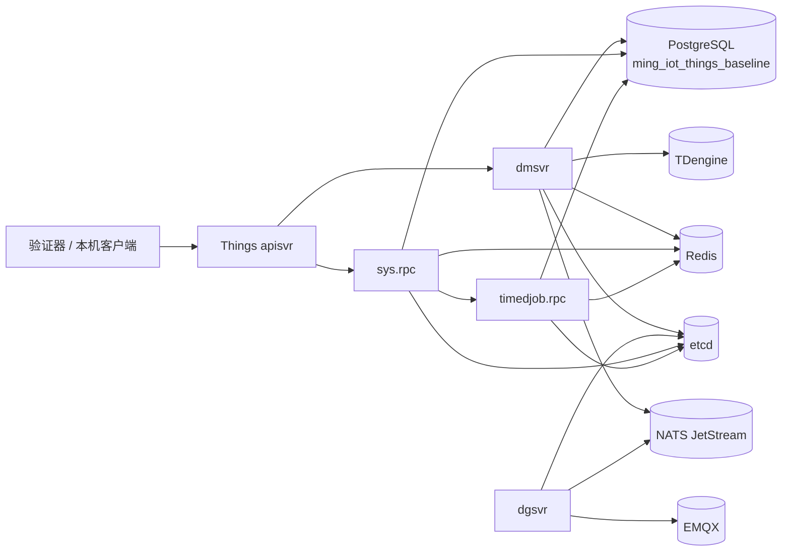

# Things 可重复启动与依赖契约基线设计

> 日期：2026-08-26
>
> Goal：`ming-iot-framework-v1`
>
> Todo：`todo_42626cceb870`
>
> 上游决策：[首个真实交付 Loop 提案](../proposals/2026-08-23-first-real-delivery-loop.md)
>
> 状态：已于 2026-08-26 获用户审批
>
> 实施计划：[Things 可重复启动与依赖契约基线实施计划](../plans/2026-08-26-things-reproducible-startup-dependency-contract-baseline.md)

## 1. 背景与问题

`ming-iot/backend/things` 已具备 `apisvr`、`dmsvr`、`dgsvr` 三个服务入口，但当前还没有一条可重复、可诊断、可留下证据的完整启动路径。Things 的真实启动又依赖 SaaS RPC、PostgreSQL、Redis、etcd、NATS、TDengine 和 EMQX，单纯证明二进制可以编译并不能证明服务可以工作。

现有 `deploy/saas/Dockerfile` 还在 Docker 构建阶段执行 `go mod download` 和 `go build`。Docker 分层缓存能减少重复下载，但它不能直接复用 WSL 宿主机已有的 `GOMODCACHE` 与 `GOCACHE`，并会在 Docker 存储中保留另一套 Go 依赖和编译缓存。当前也缺少统一的 Makefile 来约束 Go 构建、镜像构建、启动、验证和清理。

本 Loop 要建立的不是生产部署方案，而是一条真实依赖、最小业务副作用、可重复验收的 Things 启动基线。

## 2. 目标

本设计完成后，开发者应能在当前 WSL 中通过固定命令：

1. 复用宿主机 Go 缓存，静态编译 SaaS 与 Things 所需的五个二进制；
2. 按服务角色构建五个只包含运行时依赖的业务镜像；
3. 复用现有 PostgreSQL 实例，但创建并只使用独立数据库 `ming_iot_things_baseline`；
4. 启动真实的 Redis、etcd、NATS JetStream、TDengine、EMQX、`timedjob.rpc`、`sys.rpc`、`dmsvr`、`dgsvr` 和 `apisvr`；
5. 按依赖顺序验证“进程存在、协议可用、关键外部连接成立”；
6. 对成功和失败生成结构化、可脱敏、可追溯的本地证据；
7. 在不修改 Things/SaaS 业务语义的前提下，形成后续 Loop 可复用的部署入口。

## 3. 非目标

本 Loop 明确不做：

- 不把 Things 当前使用的 NATS 替换为 Kafka；
- 不设计生产高可用、容量、SLO、滚动升级或 Kubernetes 部署；
- 不调用创建设备、产品、物模型等会产生业务数据的接口；
- 不重构 SaaS 或 Things 的业务代码、RPC 边界和配置模型；
- 不迁移或删除现有 `deploy/core/`、`deploy/saas/`、`deploy/docker-compose.yml`；
- 不引入 MinIO；本基线使用隔离的本地 OSS 卷；
- 不启动当前 Things 路径不需要的 `timedscheduler.rpc`；
- 不为本基线先行增加业务服务健康检查接口；
- 不提交二进制、真实密钥、运行日志和临时数据卷。

若真实启动暴露业务代码缺陷，应保存证据并停止当前 Loop，再创建具有精确写入范围的后继 Todo，不得借本 Loop 顺带修改业务代码。

## 4. 方案选择

### 4.1 采用方案

采用“宿主机统一构建 + 运行角色全部容器化 + PostgreSQL 复用外部实例”的方案。

| 方案 | 优点 | 问题 | 结论 |
|---|---|---|---|
| 宿主机编译，所有角色独立容器运行，复用外部 PostgreSQL | 可重复、角色边界清楚、复用 Go 缓存、能验证真实依赖 | 需要维护基线配置与启动编排 | 采用 |
| 基础设施容器化，Go 服务直接跑在宿主机 | 调试方便 | 进程、环境变量和端口容易受本机状态影响，复刻性较差 | 不采用 |
| 只启动聚合式 `saassvr` / `thingsvr` | 启动项少 | 无法证明 `sys`、`timedjob`、`dm`、`dg`、`api` 的独立角色契约 | 不采用 |

### 4.2 总体拓扑



PostgreSQL 不加入本基线 Compose 网络。容器通过 `host.docker.internal` 和 `host-gateway` 访问 WSL 中已有实例，以避免依赖现有 `cloudx_net` 的具体网络结构。其他依赖由本基线 Compose 独立管理。

## 5. 目录与命令契约

### 5.1 最终目录

部署目录位于仓库根目录，与 `backend/` 同级：

```text
ming-iot/
├── backend/
└── deploy/
    ├── Makefile
    ├── README.md
    ├── images/
    │   ├── Dockerfile.sys
    │   ├── Dockerfile.timedjob
    │   ├── Dockerfile.dm
    │   ├── Dockerfile.dg
    │   └── Dockerfile.api
    ├── profiles/
    │   └── things-baseline/
    │       ├── compose.yaml
    │       ├── contract.yaml
    │       ├── .env.example
    │       ├── config/
    │       │   ├── saas/
    │       │   └── things/
    │       └── scripts/
    ├── core/                 # 现有目录，本 Loop 不迁移
    ├── saas/                 # 现有目录，本 Loop 不迁移
    └── docker-compose.yml    # 现有文件，本 Loop 不迁移
```

`deploy/` 是仓库级共享部署入口。`backend/saas/Makefile` 和 `backend/things/Makefile` 只负责各自模块的可复用构建目标；根级 `deploy/Makefile` 负责编排跨模块构建、镜像和运行生命周期。

### 5.2 用户命令

```bash
make -C deploy things-baseline-build
make -C deploy things-baseline-image
make -C deploy things-baseline-up
make -C deploy things-baseline-verify
make -C deploy things-baseline-logs
make -C deploy things-baseline-down
```

- `things-baseline-build`：在宿主机编译五个静态二进制；
- `things-baseline-image`：构建五个服务角色对应的运行时镜像；
- `things-baseline-up`：执行预检、数据库初始化、分阶段启动和最终验证；
- `things-baseline-verify`：只验证当前环境，不修改业务数据；
- `things-baseline-logs`：按组件导出脱敏诊断日志；
- `things-baseline-down`：停止并删除容器与基线网络，默认保留数据库和数据卷。

可另设 `things-baseline-reset`，但它必须要求输入明确确认文本，只能删除精确命名的基线数据库和数据卷，且不得被 `up`、测试或清理脚本自动调用。

## 6. 构建与镜像契约

### 6.1 宿主机构建

五个目标二进制为：

- SaaS：`syssvr`、`timedjobsvr`；
- Things：`dmsvr`、`dgsvr`、`thingsvr`。

构建必须显式设置：

```text
GOWORK=off
CGO_ENABLED=0
GOOS=linux
GOARCH=amd64
-trimpath
```

构建使用宿主机默认且可复用的 `GOMODCACHE`、`GOCACHE`。输出放入已忽略的 `backend/bin/`，不创建每轮一次性的 Go 模块缓存。Makefile 必须在任一目标失败时立即失败，不能继续使用旧二进制。

### 6.2 运行时镜像

按服务角色构建五个镜像，每个镜像只携带一个静态二进制。镜像、Dockerfile、二进制和容器角色必须一一明确对应：

| 容器角色 | 所属模块 | Dockerfile | 二进制 | 镜像名 |
|---|---|---|---|---|
| `sys.rpc` | SaaS | `Dockerfile.sys` | `syssvr` | `ming-iot-sys:baseline` |
| `timedjob.rpc` | SaaS | `Dockerfile.timedjob` | `timedjobsvr` | `ming-iot-timedjob:baseline` |
| `dmsvr` | Things | `Dockerfile.dm` | `dmsvr` | `ming-iot-dm:baseline` |
| `dgsvr` | Things | `Dockerfile.dg` | `dgsvr` | `ming-iot-dg:baseline` |
| `apisvr` | Things | `Dockerfile.api` | `thingsvr` | `ming-iot-api:baseline` |

`apisvr` 的源码角色名与当前产物名不同，因此规格显式保留“`apisvr` 使用 `thingsvr` 二进制”的映射，不通过隐含约定推断。

每个运行时镜像只包含 CA 证书、时区数据、对应的单个静态二进制和启动所需配置，不安装 Go 工具链，也不执行 `go mod download` 或 `go build`。五个 Dockerfile 使用相同的基础镜像版本和 OCI 标签约定，但不通过一个包含多个二进制的通用业务镜像复用运行角色。

每轮镜像构建必须记录：

- Git revision；
- 各二进制 SHA-256；
- 镜像 ID；
- 配置契约摘要。

若二进制摘要与当前源码/构建清单不一致，`image` 或 `up` 必须以 `CONTRACT_MISMATCH` 失败，禁止静默复用陈旧产物。

现有 `deploy/saas/Dockerfile` 继续服务旧部署路径，本 Loop 不修改，也不用于新基线。

## 7. 配置、密钥与数据隔离

### 7.1 基线专用配置

本基线使用 `deploy/profiles/things-baseline/config/` 下的独立配置，不直接复用现有 `*Docker.yaml`。原因是旧配置可能携带不适合本基线的 PostgreSQL/TDengine 模式、地址和聚合服务假设。

运行前把源码中的 `init/`、`i18n/` 等只读资源和基线 YAML 组装到：

```text
deploy/.runtime/stage/
```

该目录必须被 Git 忽略。组装过程必须可重复，且不得回写源配置。

### 7.2 密钥

- `.env.example` 只保存变量名和非敏感默认值；
- 真实值保存在已忽略的 `.env.local` 或 `deploy/.runtime/secrets/`；
- 密钥文件权限必须为 `0600`；
- EMQX API 凭据通过 bootstrap 文件初始化，不写入 Git；
- 日志和证据不得包含完整 DSN、密码、令牌或 API Secret。

### 7.3 PostgreSQL

复用现有 PostgreSQL 实例，但必须幂等创建：

- 独立角色；
- 独立数据库 `ming_iot_things_baseline`；
- Things/SaaS 当前需要的扩展，包括 PostGIS。

在任何应用容器启动前，必须验证目标数据库名。若 DSN 指向 `iThings` 或其他非基线数据库，立即以 `CONFIG_INVALID` 或 `CONTRACT_MISMATCH` 失败。初始化和清理逻辑不得对 `iThings` 执行建表、迁移、清空或删除操作。

### 7.4 其他数据

- 所有容器、网络和卷使用统一的基线前缀；
- 本地 OSS 使用独立卷；
- `down` 默认保留基线数据库和卷，以支持暖启动验证；
- 只有显式 `reset` 才能删除精确命名的基线资源；
- 本基线不配置无限重启策略，避免失败被自动重启掩盖。

## 8. 启动状态机

启动必须按以下有限状态机推进：

```text
PRECHECK
  → DATABASE_BOOTSTRAP
  → INFRA_READY
  → TIMEDJOB_READY
  → SYS_READY
  → DM_READY
  → DG_PROCESS_READY
  → DG_LINK_READY
  → API_READY
  → VERIFIED
```

顺序约束：

1. `PRECHECK` 校验 Docker、Compose、端口、配置、密钥权限、外部 PostgreSQL 可达性和数据库保护规则；
2. `DATABASE_BOOTSTRAP` 创建独立角色、数据库和扩展；
3. `INFRA_READY` 等待 Redis、etcd、NATS JetStream、TDengine、EMQX；
4. 先启动 `timedjob.rpc`，再启动可能依赖它的 `sys.rpc`；
5. SaaS RPC 可用后再启动 `dmsvr`；
6. `dgsvr` 的进程就绪与 EMQX 连接就绪分开判断；
7. 最后启动 `apisvr` 并执行无业务副作用的端到端验证。

每一阶段必须有有限超时。阶段失败后停止继续启动，但保留容器、状态和日志供诊断。

## 9. 就绪契约

“容器运行中”不等于“组件就绪”。每个组件至少满足以下契约：

| 组件 | 就绪条件 |
|---|---|
| PostgreSQL | `pg_isready` 成功；当前数据库精确等于 `ming_iot_things_baseline`；PostGIS 可查询 |
| Redis | `PING` 返回 `PONG` |
| etcd | `etcdctl endpoint health` 成功 |
| NATS | `/healthz` 返回成功；JetStream 已启用并可查询 |
| TDengine | taosAdapter `/-/ping` 成功；执行一条真实 SQL 成功 |
| EMQX | `emqx ctl status` 成功 |
| timedjob / sys / dm | 进程存活、端口监听、gRPC reflection 可访问；需要注册的角色还必须出现在 etcd |
| dg 进程 | gRPC reflection 可访问 |
| dg 链路 | EMQX 管理 API 能观察到预期客户端 `dg.rpc` 已连接 |
| api | HTTP 端口可访问，并返回约定的非业务写入响应 |

就绪实现应遵循组件官方接口，而不是依赖日志文本猜测：

- [etcd 集群状态检查](https://etcd.io/docs/v3.5/tutorials/how-to-check-cluster-status/)
- [NATS 监控端点](https://docs.nats.io/running-a-nats-service/nats_admin/monitoring)
- [TDengine taosAdapter 参考](https://docs.taosdata.com/reference/components/taosadapter/)
- [EMQX Docker 部署](https://docs.emqx.com/en/emqx/latest/deploy/install-docker.html)
- [EMQX REST API](https://docs.emqx.com/en/emqx/latest/admin/api.html)

## 10. 失败契约

所有脚本和验证器必须返回非零退出码，并输出统一 JSON 诊断对象：

```json
{
  "stage": "DG_LINK_READY",
  "component": "dgsvr",
  "code": "DEPENDENCY_NOT_READY",
  "reason": "EMQX 中未观察到预期客户端连接",
  "logRef": "deploy/.runtime/runs/<run-id>/logs/dgsvr.log"
}
```

稳定错误码至少包括：

- `BUILD_FAILED`
- `CONFIG_INVALID`
- `EXTERNAL_DEPENDENCY_UNAVAILABLE`
- `DATABASE_BOOTSTRAP_FAILED`
- `DEPENDENCY_NOT_READY`
- `ROLE_EXITED`
- `ROLE_NOT_READY`
- `CONTRACT_MISMATCH`
- `TIMEOUT`

错误信息必须说明阶段、组件、稳定错误码、脱敏原因和日志引用。不得把完整环境变量或凭据拼入错误文本。

## 11. 验证分层

### 11.1 Fast 验证

Fast 验证用于日常本地门禁，应保持短小：

- Makefile 与配置契约单元测试；
- `docker compose config`；
- 密钥与危险数据库名扫描；
- 五个静态二进制的编译检查；
- 启动验证器自身的单元测试。

Fast 验证不启动完整依赖环境，适合作为常规提交前检查。

### 11.2 Full 验收

Full 验收只在本 Loop 验收、重大依赖变更或人工显式触发时执行，不放入每次 pre-push：

1. 新数据库、新卷的冷启动；
2. 保留数据库和卷后的暖重启；
3. DSN 指向 `iThings` 时被硬拒绝；
4. Redis、TDengine、EMQX 或 SaaS RPC 缺失时返回稳定失败；
5. `dgsvr` 进程存活但未连接 EMQX 时不能判定就绪；
6. 全程不调用产品、设备、物模型等业务写接口。

## 12. 证据契约

每次运行在已忽略目录生成原始证据：

```text
deploy/.runtime/runs/<run-id>/
├── evidence.json
├── versions.json
├── compose-config.sha256
├── binary-sha256.json
└── logs/
```

`evidence.json` 至少记录：

- 总体结果与各阶段结果；
- 每阶段开始、结束和耗时；
- Docker、Compose、依赖组件和应用版本；
- 非敏感配置摘要；
- Git revision、二进制摘要、镜像 ID、契约摘要；
- 每个就绪探针的结果；
- 失败码、脱敏原因和日志引用。

原始运行目录不提交。验收完成后，由人明确选择一份已脱敏摘要复制到 `ming-iot-rd-docs/evidence/`，作为当前 Todo 的最终证据。证据不得包含真实凭据或完整 DSN。

## 13. 预期实现范围

实施计划应把写入范围限制在：

```text
ming-iot/deploy/Makefile
ming-iot/deploy/README.md
ming-iot/deploy/images/**
ming-iot/deploy/profiles/things-baseline/**
ming-iot/backend/saas/Makefile
ming-iot/backend/things/Makefile
ming-iot/backend/tools/cmd/thingsstartbaseline/**
ming-iot/backend/tools/internal/thingsstartbaseline/**
ming-iot/backend/tools/**/*test.go
ming-iot/.gitignore
ming-iot/backend/tools/README.md
```

默认禁止修改：

```text
ming-iot/backend/saas/service/**
ming-iot/backend/things/service/**
```

实施前必须先在 LoopX 中创建并批准覆盖上述精确范围的后继 Todo。当前 Todo 只负责形成和审批规格，不授权产品实现写入。

## 14. 验收标准

本 Loop 的实施结果只有同时满足以下条件才可验收：

1. 一个命令可以从已声明的前置条件启动完整基线；
2. 五个二进制均由宿主机静态编译，并一一封装成五个业务镜像；每个镜像只包含对应二进制且不存在 Go 工具链；
3. 现有 PostgreSQL 实例被复用，但只写独立数据库 `ming_iot_things_baseline`；
4. 所有依赖和服务都通过协议级就绪探针，而非只看容器状态；
5. 冷启动、暖重启和核心失败场景均有可重复结果；
6. `iThings` 保护、密钥脱敏和精确 reset 边界有自动化测试；
7. 运行产物不进入 Git，最终脱敏证据进入本地研发文档仓库；
8. 未发生未授权的业务代码修改；
9. 独立 Review 能从规格、实现、测试和证据之间建立逐项对应关系。

## 15. 后续 Loop

本基线验收后，才能把它作为后续工作的环境前置条件，例如：

- 将本地 `share` 迁入 `ming-iot`；
- 拆分 `dmsvr` 巨型 `dm.proto`；
- 迁移消息通道到 Kafka；
- 建设新的物模型、Reducer、Scene 等真实业务能力。

这些工作必须分别创建 Todo，不得扩大本基线的写入范围。
