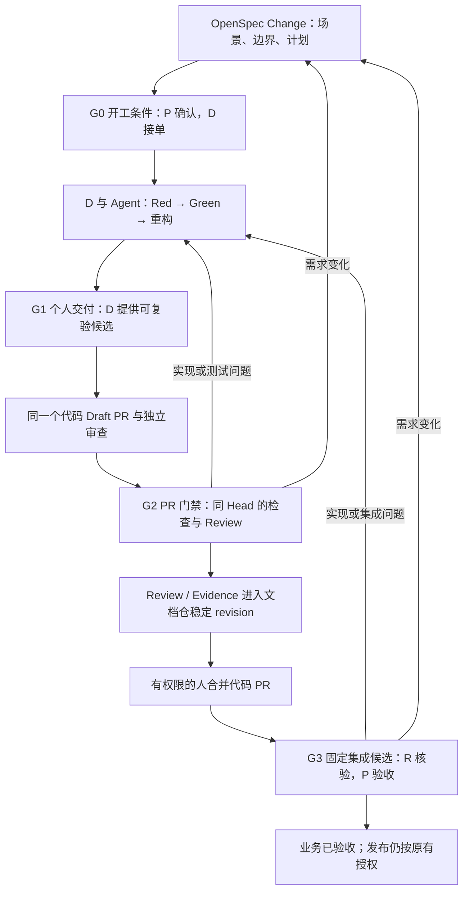

# 一条 IoT 需求的责任与验收走查

日期：2026-10-10

状态：责任分离与验收时点两项关键政策已由用户于 2026-10-10 确认。本文是 [团队责任与关键节点验收决策](../issues/04-responsibility-gates.md) 的走查材料，不是已批准的业务规格，也不是运行或验收记录。业务场景、角色代号、版本代号仍用于推演；本次没有实施需求、运行业务测试、创建 PR 或启用门禁。

## 1. 先约定责任，而不增加岗位

| 责任 | 必须对什么负责 | 每条需求的动作 |
| --- | --- | --- |
| 需求验收人 P | 业务行为、范围取舍、最终业务验收 | 认可场景及边界；处理规格变更；根据固定集成候选的结果作验收决定 |
| 交付责任人 D | 从计划到可复验交付的完整性 | 协调实施 Agent、测试和依赖；提交代码、验证证据与剩余项；接收并修复退回问题 |
| 独立评审人 R | 对同一候选的工程审查及独立验证判断 | 对照规格检查实现、测试及证据，给出通过或具体 findings；验证交接材料可用 |

已确认：D 与最终 PR 审查者 R 由不同成员承担；P 可以兼 R。每条需求至少两位成员，三个角色不要求三个岗位。真实姓名/账号只填在现有 Delivery Issue，其他记录引用它。未认领 R 的需求可以探索、开发，但不能进入“已独立审查通过”。

实施 Agent 对应 D；独立 Review Agent 使用不同身份和独立上下文，接受规格、候选差异与证据，自行判断，不能只复述实施者结论。Review Agent 的输出是审查依据；具体人对 PR 的处理仍由 R 负责。现行仓库要求 Reviewer 不修改实施代码，问题回到 D 修复。

验证环境由 D 对本需求负责维护或协调已有维护者修复，不另设一个审批岗位。集成运行可以由 CI、D 或 R 发起；R 核对证据来源与关键结果，P 作业务验收。部署操作沿用既有发布责任与精确授权，不混入“集成通过”。

## 2. 示例需求与边界

**示例：已接入设备上报温度后，所属租户可以通过最新遥测查询接口看到该值。**

选择该例是为了覆盖设备入口、内部传输、数据处理、查询和租户权限。它不是从现有仓库确认过的已批准业务需求，接口、协议与验收时间均需在真实试点定界时确认。

| 场景标识 | 输入 | 示例预期 | 证据应能说明什么 |
| --- | --- | --- | --- |
| S1 正常链路 | 已认证的租户 A 设备 D 上报温度 26.5 | A 查询 D 的最新遥测得到 26.5；在约定的观察窗口内可见 | 同一次输入经过真实设备接入协议、实际配置的消息链路、存储与查询接口；可追溯设备和请求 |
| S2 租户隔离 | 租户 B 查询 A 的设备 D | 按平台既有拒绝约定返回，不能泄露设备遥测 | 原始请求/响应经过脱敏；明确拒绝而不是前端隐藏 |
| S3 异常值 | D 上报非数值温度 | 异常输入被按约定处理，不把最新有效温度污染成错误值 | 失败处理和后续查询结果可关联；具体拒绝/隔离行为由 P 确定 |
| S4 兼容性 | 旧设备继续上报不含温度的既有合法消息 | 旧消息原有处理行为仍成立 | 既有回归场景在相同候选上保持通过 |

真实开工前必须填清：上报协议和身份、字段类型/单位、缺失及异常处理、查询接口与权限约定、“最新”的顺序语义、可观察完成条件及超时处理。演示不预设吞吐量、性能 SLA、去重保证或硬件支持已成立。

范围建议：沿用已有认证、传输与顺序约定；不在这条示例里顺带换消息中间件、重做物模型或增加 UI。若查不到已有约定，P 明确选定本次语义后再开工。

如果用模拟设备经真实协议接入，只证明该协议与服务链路；若验收包含实际设备/固件，必须补相应型号和固件上的证据。Broker ACK 或单个服务健康检查不能替代 S1 的查询结果。

## 3. 一条交付经过四个关口



已确认的时点是：**最低必需验证在合并前完成，完整业务集成在合并后、发布前验收。按现行变更面要求必须执行的集成 suite，仍须在合并前完成。** 合并只确认代码进入目标分支，业务验收针对实际选定的完整代码与环境组合；两者分别记录。

### G0：能否开始这条需求

| 项目 | 具体要求 |
| --- | --- |
| 负责 | P 认可意图，D 接收执行责任；指定 R |
| 输入 | 一条 Delivery Issue，OpenSpec Change，现行接口/协议与相关代码入口 |
| 交付 | Change 内的场景与非目标、必要设计、tasks；D/P/R 归属；受影响仓库与依赖；验证入口及需补齐的测试计划 |
| 最小证据 | P 对明确规格版本 S0 的确认记录；D 的接单与复述，表明知道如何验证 S1–S4 |
| 通过 | 场景可观察、边界清楚、责任已认领；依赖可取得或已安排有界准备任务；每个场景有验证方式和失败归属 |
| 退回 | “最新”含义不清、接口或权限约定矛盾 → P；环境/测试入口缺失 → D 补准备，不让 AI 猜成默认需求 |

G0 的确认针对本次 Change 的业务边界，不为每个 Task 新建审批。后续在该边界内的编码、测试、修复、内部交接连续推进。新方向、范围变化、风险接受和既有高风险动作才进入相应决策。

### G1：交付者是否已经完成个人验收

| 项目 | 具体要求 |
| --- | --- |
| 负责 | D；实施 Agent 提供原始结果，D 对完整性负责 |
| 输入 | 已确认的 S0、当前代码基线、测试数据和环境定义 |
| 交付 | 不可变代码候选 H1，新增/更新测试，可重放命令，文档差异说明，Evidence 摘要与原始产物指针 |
| 最小证据 | Red 是预期业务断言失败；Green 是同一组或有审查解释的测试在候选上通过；实际验证命令、环境、退出状态、未运行项均可回读 |
| 通过 | S1–S4 各有实际证据；适用最低 Profile 通过；没有未解释的规格偏移；另一成员可以取得环境、输入和结果 |
| 退回 | 正常路径只测了 mock、跨租户用例遗漏、Red 其实是依赖没启动、测试被削弱才变绿 → D；业务语义发生变化 → P |

不强制每次 Red/Green 都新增一份 Markdown 或一次 commit。Red 可以由测试提交或可重放的测试补丁配合基线记录；Green 绑定实际候选。测试/运行身份和报告由验证脚本或 CI 自动采集，不要求人抄写日志。

G1 验证 D 的开发候选及其声明的依赖基线；G3 验证最终交付所选的完整版本组合。两者输入相同且有可核查的等价依据时，可引用已有运行结果；不为了多一个关口机械重复全部测试。

当前 `make verify-pr` 是必跑的工程基线，但它不启动外部服务。`kafka`、`things-startup` 等现有 suite 仅在对应变更面适用，不能因为命令叫 integration 就宣称覆盖温度业务场景。示例所需的 S1–S4 测试入口是试点中待提供的工作，不虚构一个当前已存在的 `telemetry` suite。

### G2：是否可以让这份代码进入合并流程

| 项目 | 具体要求 |
| --- | --- |
| 负责 | R 作独立审查，D 修复；有权限的人执行最终合并 |
| 输入 | 同一个 Draft PR、S0、完整候选 H1、验证结果、全部相关差异；Reviewer 自行回读规范和代码 |
| 交付 | 绑定 H1 的独立 Review：结论、findings、覆盖范围、blocker/warning；必要验证的可信结果；稳定文档 revision |
| 最小证据 | PR checks 实际运行结果；Review 作者/Agent 身份；R 对场景与实现对齐的判断；场景证据可从原始产物复验 |
| 通过 | 必需检查通过，无未解决 blocker，Review 确实针对 H1，证据可读；Review/Evidence 已按现行规则合入文档仓，代码 PR 引用该 revision |
| 退回 | blocker → D 在同一个 PR 修复；规格缺陷 → P；候选 Head 改变 → 旧 Review 保留为历史，新 Head 重新验证受影响范围并出具新回执；证据不可访问 → D 修复交付材料 |

R 不需要手抄或手跑所有已有可信 CI 结果，但必须独立检查测试是否能证伪要求，并核实关键路径。由新会话或另一环境复现至少一条业务链路，能够检验交接材料是否足够；试点应特别验证租户隔离场景。CI 来源、候选或环境不可信时不能只接受截图或 PASS 文本。

Reviewer 发现问题不直接修作者分支：发出 findings，D 修复，再审同一个 PR 的新 Head。这样审查责任与实现责任可分辨，也避免 R 修完后自己给自己的修改出具独立结论。

### G3：这条业务需求能否被验收

| 项目 | 具体要求 |
| --- | --- |
| 负责 | D 准备集成候选；R 核验可复验性及结果；P 对业务目标作最终验收 |
| 输入 | 各代码仓准确的合并结果或选定候选 commit、制品摘要、环境配置版本、迁移/数据基线、S0 和验证入口 |
| 交付 | 固定的候选组合 C1；S1–S4 的集成结果；未覆盖项；P 对 C1 的验收结论 |
| 最小证据 | 运行中的服务确实对应 C1；真实消息入口到查询的端到端结果；R 可回读/重放；P 的验收记录关联同一 C1 |
| 通过 | 所有本次必需场景达到已确认标准；前后端/服务/数据库接口与配置兼容；没有未知、未运行或失效证据被当成通过 |
| 退回 | 代码缺陷或组合不兼容 → D；环境不足 → 环境 BLOCKED、验证 NOT_RUN，D 协调；规格遗漏 → P；部分仓库合入 → D 按兼容/回滚计划处理，不宣称整体可用 |

完整集成失败时，业务需求保持“未验收”；已经合并的 PR 保留真实合并事实，不改写成未合并。本次交付不能据此发布；是否回滚、停用还是继续修复按影响和已有授权决定。紧急风险接受走现行精确 Gate，不以“多数测试已绿”静默豁免。

合并结果和预先验证的候选不同，或配置、数据/schema、测试契约变化时，重跑受影响验证。复用旧证据必须有可审计的版本等价/适用性依据，不能仅用“代码差不多”。集成通过不等于生产已部署；OpenSpec 同步/归档也不等于发布授权，按项目生效规则更新记录。

## 4. 走一次退回与重交

以下是模拟路径，不是已发生的测试结果。`S0/H1/H2/D2/M2/C1` 都是说明用代号，不是实际 Git SHA。

1. **P 与 D 定界。** 认可 S0 的 S1–S4、非目标和可观察完成标准，指定 R。Change 内 tasks 包含测试入口、实现、个人验证和集成；不复制成一套逐项 LoopX 待办。
2. **D 做 Red。** 新增温度查询测试，现有实现缺少目标行为，断言失败。若失败原因是数据库没启动，这次记录为环境失败，不能作为 Red 证据。
3. **D 做 Green，形成 H1。** 实现并运行验证，创建或更新代码 Draft PR，交出 S0、H1、证据与恢复入口。
4. **R 发现 tenant 条件没有传到查询层。** 即使工程测试全绿，也按 S2 退回；findings 指明场景、位置、复现方式与预期。D 增加能复现问题的测试并修复，形成 H2。
5. **R 对 H2 重审。** H1 的 Review 保留但不再授权 H2。H2 的必要验证与 Review 通过后，最终摘要经文档 PR 合入到 D2，代码 PR 正文更新为引用 D2；不为了更新这个指针再改代码 commit，避免形成循环追版本。
6. **有权限的人合并代码 PR。** 实际合并结果为 M2。若涉及多个代码仓，各自记录合并结果、依赖顺序与兼容范围，不能用一个“全合并”复选框代替组合清单。
7. **集成环境构建 C1 并验收。** C1 包含 M2 及其他依赖仓库的固定版本。发送实际协议消息，查询业务结果；R 验证记录和关键场景，P 对 C1 验收。此时才结束本次业务交付验收；发布仍受原有规则约束。

若步骤 7 因旧环境配置失败，只重做配置修复和受影响验证；若需要改代码，回到同一个 Delivery Issue 下的新修复候选/必要后续 PR，旧 PR 已合并的事实不改写。若要改变温度字段或权限行为，先回到 P 修改并认可规格版本 S1，再据此更新实现、测试与证据。

## 5. 最少记录：人写意图与判断，机器记录运行事实

| 信息 | 唯一人工维护位置 | 其他位置怎么使用 |
| --- | --- | --- |
| 场景、非目标、必要设计、tasks | 目标流程中的一个 OpenSpec Change | Issue、PR、LoopX 保存引用；不维护平行 Spec/Plan 正文 |
| P/D/R、当前交付归属、决策入口 | 现有 Delivery Issue | Change/PR 引用；角色变动保留事件，不另写人员台账 |
| 工程判断与 findings | 现行文档仓 Review，绑定候选 | PR 显示短结论和引用；D 按 finding 修复，不复制全文 |
| 命令、结果、环境、输入、原始报告 | CI/现有 Evidence 产物存储 | 文档仓 Evidence 保存脱敏摘要与稳定指针；PR 展示同一记录的摘要 |
| 业务验收 | Issue 或项目已有验收记录的一次带版本结论 | 明确 C1、场景范围、证据和验收人，其他页面引用它 |

“一份证据记录”不要求只有一个物理文件。原始日志、报告、截图可由一次运行产生多个文件；索引必须能指回同一次运行、同一候选和对应场景。个人验收、Review、集成验收是不同责任的结论，可以引用同一证据，不能合成一个无人负责的总 PASS。

建议自动采集的最小信息如下，映射现有 Evidence/CI 格式即可，**不新增第二套必填 schema**：

```text
交付身份：Delivery Issue + OpenSpec Change
意图版本：本次批准的 spec revision / 必要文件摘要
代码候选：每仓 repo + base/head 或实际 merge commit；构建制品摘要
环境输入：镜像/依赖锁、配置/schema、测试数据版本（不包含密钥）
验证入口：测试代码/脚本版本、命令、实际范围、run ID、执行时间/身份
结果：各场景 PASS / FAIL / NOT_RUN，原因及原始产物指针
人工结论：签署者、明确范围、绑定候选、证据引用、未解决项
```

其中“意图版本”和“最终 Review/Evidence 所在文档 revision”分别记录：最终文档提交可以只增加审查与证据，不改变已认可的业务语义。若业务内容变了，才重新识别规格版本与受影响验证。避免代码与文档为互相更新对方最新 SHA 而无限补 commit。

默认不新增：每日 Markdown 周期进度、手写 changelog、每一步验收文档、每个 Task 的独立 LoopX Todo、每次提交的 runbook、复制在多个工具中的状态表。只有出现新且可复用的稳定经验，才补经验文档；发布摘要从实际 Change/PR 生成。

交接只发一次简短回执：`Issue/Change、意图版本、各仓候选、证据入口、剩余/阻塞、下一步、交出人/接收人`。接收人应回读并说明接收或缺什么；消息发送成功不等于已经接棒。LoopX 只保存这些薄引用及推进状态。

## 6. 门禁在哪里执行

- **本地检查/Hook**：提供快速反馈，无法证明远端强制执行。
- **PR 必需检查与分支权限**：检查最低 Profile、精确候选与有效 Review/Evidence；禁止以模板打勾替代真实结果。当前服务端配置未核实，因此本文只定义目标约束。
- **集成任务**：从固定候选组合启动受控环境，验证实际运行版本与业务结果。集成场景未运行就保留 NOT_RUN。
- **人**：P 处理语义、范围和业务验收；R 处理独立工程判断；高风险动作沿用现有精确授权。普通修复与已授权内部步骤不追加人工 Gate。

若服务端暂时不能强制某项检查，由指定合并者逐项核实并留下人工执行记录，明确标为人工门禁；不能据此声称具备自动不可绕过的保障。后续启用自动门禁是独立实施工作，本轮未配置。

## 7. 当前项目接入事实与待补项

2026-10-10 限定只读核查：

1. 产品和研发文档仓根目录尚无 `openspec/`。OpenSpec 是本次确定的目标结构；正式接入前应在文档仓完成一次权威映射和校验器适配，迁移后只维护一份业务内容，不同时手写旧 Spec/Plan 与新 OpenSpec。
2. 当前文档仓仍使用 `specs/`、`plans/`、`reviews/`、`evidence/`；`map/README.md` 明确地图布局仍为设计试点。本走查不把候选 activation 规则冒充已启用规则。
3. 现行规则要求同 Head 的独立 Review；最终 Review/Evidence 先合入文档仓，代码 PR 再引用稳定 revision 后退出 Draft。减负优先自动生成摘要和链接，不静默跳过该顺序。
4. 已有 `verify-fast`、`verify-pr`、`verify-integration`、`verify-release` 入口；`verify-pr` 不启动外部服务，现有集成选择为 `kafka`、`things-startup`。没有证据证明它们已覆盖本例的业务温度链路。
5. 本地常见 CI 配置位置未发现工作流，不据此断言服务端没有 CI；服务端必需检查、分支保护和团队账号映射仍待核实。
6. 本次没有实际选择业务 Delivery Issue，也没有读取/改变运行中的 LoopX Goal。本方案将来进入真实 IoT 项目时，仍按项目既有 Todo、write scope、独立 worktree 与文档登记约定执行。

来源：

- [产品协作约定：实施、Review、验证与合并](/home/wangjunbo/workspace-iot-platform/ming-iot/AGENTS.md:19)
- [文档协作约定：职责和双仓记录](/home/wangjunbo/workspace-iot-platform/ming-iot-rd-docs/AGENTS.md:25)
- [现行交付设计：Review、Evidence 与双仓 PR 顺序](/home/wangjunbo/workspace-iot-platform/ming-iot-rd-docs/specs/2026-09-03-ming-iot-gitee-delivery-and-verification-profile-design.md:369)
- [验证入口与依赖范围](/home/wangjunbo/workspace-iot-platform/ming-iot/deploy/README.md:3)
- [地图的设计试点状态](/home/wangjunbo/workspace-iot-platform/ming-iot-rd-docs/map/README.md:5)
- [Things 模块当前仅为 L0 基线](/home/wangjunbo/workspace-iot-platform/ming-iot/backend/things/README.md:21)

## 8. 已确认政策与后续实例化

- 2026-10-10，用户选择“两位成员独立承担交付和审查”：D 与 R 分离，P 可兼 R；独立 AI 审查可以辅助 R，不能替代另一位成员承担审查责任。
- 同次答复选择“最低必需验证在合并前，完整集成在合并后、发布前”：完整业务集成未通过，本次业务需求仍未验收，本次交付不能据此发布；适用的合并前集成要求保持不变。

这两项选择使本票据的责任与验收安排可以作为后续设计依据。具体人员在真实 Delivery Issue 认领；真实需求、场景参数、测试入口和环境由后续“哪条真实 IoT 需求能检验方案，怎样判断值得推广？”票据实例化；最小文档及 OpenSpec 接入方式进入文档维护票据。此文不能替代业务场景、上线授权或实测证据。
