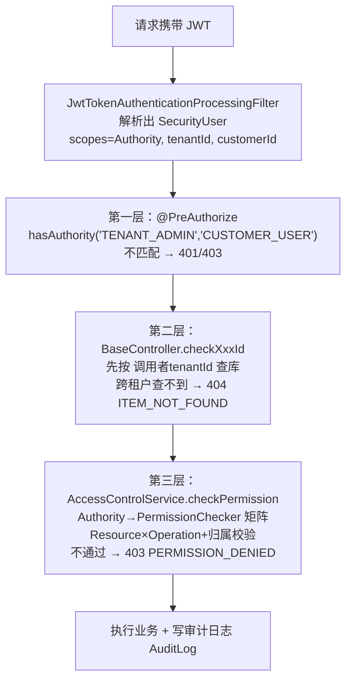

# ThingsBoard 权限体系竞品调研报告

> 状态：竞品调研。事实取自本地源码（关键结论已逐行核验），PE 部分取自官方文档；仅作授权与鉴权方案的对照参考，不改变主架构文档已冻结的语义。
> **调研对象**：ThingsBoard 开源版（CE）`4.4.0-SNAPSHOT`（本地源码 `workspace-iot-platform/thingsboard/`，含 Java 后端与 ui-ngx Angular 前端）
> **对照项目**：ming-iot（基于联犀 core + things 二开，Go/go-zero 技术栈）
> **调研日期**：2026-08-14
> **文中路径约定**：`tb/` = `thingsboard/`，`saas/` = `ming-iot/backend/saas/`

---

## 0. TL;DR

ThingsBoard CE 的权限体系可以用一句话概括：

> **三级固定角色（Authority）× 资源（Resource）× 操作（Operation）的硬编码权限矩阵，叠加"租户 → 客户"两级数据归属隔离；角色在 CE 中不可自定义，菜单、接口、按钮全部围绕 Authority 静态裁剪；可配置的细粒度 RBAC（用户组/实体组/组角色）是商业版 PE 的付费能力。**

| 维度 | ThingsBoard CE 的做法 | 一句话评价 |
|---|---|---|
| 菜单权限 | 前端代码里按 Authority 静态映射三棵菜单树（`defaultUserMenuMap`），路由 `data.auth` + AuthGuard 拦截 | 简单、零歧义，但改菜单要发版，无法按租户定制 |
| 访问权限 | `@PreAuthorize(hasAuthority)` 粗粒度注解 + `AccessControlService` 按 Resource×Operation 逐实体校验，默认拒绝 | 双层防御扎实，但权限矩阵写死在 Java 里 |
| 数据权限 | 所有实体带 `tenant_id`/`customer_id`，DAO 层强制按租户过滤，跨租户直接 404 | 隔离非常硬，靠"查不到"而非"拒绝" |
| 设备权限 | 设备通过 `customerId` 分配给客户；客户用户对已分配设备有固定操作白名单（含读写遥测、RPC，但不可删/不可改凭据） | 分配模型清晰，但**无设备级只读开关、无属性级权限**（那是 PE 的 Entity Group + Group Role 或联犀的物模型分享权限） |

对 ming-iot 最有价值的四个观察（详见第 9~11 章）：

1. **TB 的 Operation 枚举把 IoT 特有动作（读凭据、读遥测、RPC 调用、认领设备）作为一等权限公民**，比"增删改查"模型贴合 IoT 场景，值得借鉴。
2. **TB 默认拒绝（default deny），而联犀系中间件对"未导入的 API"默认放行**（`roleApiAuthLogic.go:40-42` 已核实），这是一个安全短板。
3. TB CE 角色不可配置、菜单硬编码，恰是 ming-iot（联犀系动态菜单 + 多角色）已有的优势；TB PE 的 Group Role/Entity Group 设计则是"按实体集合授权"的成熟参考。
4. **两边身份语义完全不同构**：TB 是三级静态 Authority 枚举；saas 没有身份枚举，由"default 租户 + 角色 code + 租户表 AdminUserID/AdminRoleID"推导——注意命名陷阱：saas 的 `IsSuperAdmin` 实际是**租户管理员**，`IsRoot()` 才是平台超级管理员。两个项目都没有多层租户/租户超级管理员（补充设计见同目录 [tenant-hierarchy.md](./tenant-hierarchy.md)），也没有游客身份。详见第 10.1 节。

---

## 1. 权限体系总览

### 1.1 概念模型

```
SysAdmin（平台管理员，tenantId 为空）
 └─ Tenant（租户，由 SysAdmin 创建，受 TenantProfile 配额约束）
     └─ TenantAdmin（租户管理员，该租户内几乎全权）
         └─ Customer（客户，租户下的业务分组/终端客户）
             └─ CustomerUser（客户用户，只能操作"分配给本客户"的实体）

权限 = f(Authority, Resource, Operation, 实体归属)
  - Resource：被操作对象的类型（DEVICE、DASHBOARD、ALARM…共 32 种）
  - Operation：动作（READ、WRITE、RPC_CALL、READ_TELEMETRY…共 18 种）
  - 实体归属：tenant_id / customer_id 是否与当前用户匹配
```

要点：

- **User 实体上没有任何 role 外键**（`tb/common/data/src/main/java/org/thingsboard/server/common/data/User.java` 只有 `tenantId`、`customerId`、`authority` 三个关联字段）。"角色"就是 Authority 枚举 + 归属层级，**CE 不存在 Role 表、角色层级、角色组**。
- 这是刻意的架构取舍：CE 用"简单但固定"换"安全且零配置"；可配置 RBAC 是 PE 卖点（见第 8 章）。

### 1.2 一次 API 请求的权限校验链路



这个"**先隔离、后鉴权**"的顺序是 TB 数据安全的根基：跨租户的 ID 根本走不到权限判断那一步，直接以 404 掩盖实体的存在性（不向攻击者泄露"存在但无权"的信息）。

---

## 2. 角色模型：三级 Authority

`tb/common/data/src/main/java/org/thingsboard/server/common/data/security/Authority.java`：

```java
SYS_ADMIN(0), TENANT_ADMIN(1), CUSTOMER_USER(2),          // 用户角色
REFRESH_TOKEN(10), PRE_VERIFICATION_TOKEN(11), MFA_CONFIGURATION_TOKEN(12);  // JWT 用途的"伪角色"
```

派生判断在 `User.java`（`isSystemAdmin()` / `isTenantAdmin()` / `isCustomerUser()`），本质是"tenantId 是否为空 + customerId 是否为空"的层级判断。

Authority 同时决定了每个角色的**资源上限**：`tb/application/src/main/java/org/thingsboard/server/service/security/permission/DefaultAccessControlService.java` 在启动时注册三张权限表：

```java
authorityPermissions.put(Authority.SYS_ADMIN, sysAdminPermissions);        // → SysAdminPermissions
authorityPermissions.put(Authority.TENANT_ADMIN, tenantAdminPermissions);  // → TenantAdminPermissions
authorityPermissions.put(Authority.CUSTOMER_USER, customerUserPermissions);// → CustomerUserPermissions
```

三张表都是 `HashMap<Resource, PermissionChecker>`，**未注册的 Resource 一律拒绝**（default deny）。

- `SysAdminPermissions`：平台级资源（租户管理、TenantProfile、全局设置、OAuth2/Mobile 等）。
- `TenantAdminPermissions`：租户级资源的全量操作；唯一约束是 `user.tenantId == entity.tenantId`（同租户即放行）。
- `CustomerUserPermissions`：仅注册 16 种资源（本人逐行核实）：ALARM、ASSET、DEVICE、CUSTOMER、DASHBOARD、ENTITY_VIEW、USER、WIDGETS_BUNDLE、WIDGET_TYPE、EDGE、RPC、DEVICE_PROFILE、ASSET_PROFILE、TB_RESOURCE、MOBILE_APP_SETTINGS、API_KEY，且每种只有固定操作子集（详见第 6.3 节设备部分）。

**认证与账号状态**（简述）：无状态 JWT（`ThingsboardSecurityConfiguration` 中 `STATELESS` + RestLoginFilter/JwtTokenFilter/RefreshTokenFilter/ApiKeyFilter），JWT claims 含 `sub(邮箱)、scopes(Authority)、tenantId、customerId、enabled、isPublic`。账号禁用通过 `UserCredentials.enabled` 控制，令牌解析时校验，禁用即抛 `DisabledException`；支持多次失败锁定（审计 ActionType `LOCKOUT`）、PAT 个人访问令牌按用户冒充、OAuth2 登录、令牌主动失效（TokenOutdatingService）。

---

## 3. 权限的定义：Resource × Operation

- **Resource**（`tb/application/.../service/security/permission/Resource.java`，32 个）：ADMIN_SETTINGS、ALARM、DEVICE、ASSET、CUSTOMER、DASHBOARD、ENTITY_VIEW、TENANT、RULE_CHAIN、USER、WIDGETS_BUNDLE、WIDGET_TYPE、OAUTH2_CLIENT、DOMAIN、MOBILE_APP（_BUNDLE）、OAUTH2_CONFIGURATION_TEMPLATE、TENANT_PROFILE、DEVICE_PROFILE、ASSET_PROFILE、API_USAGE_STATE、TB_RESOURCE、OTA_PACKAGE、EDGE、RPC、QUEUE、VERSION_CONTROL、NOTIFICATION、MOBILE_APP_SETTINGS、JOB、AI_MODEL、API_KEY。每个 Resource 映射到 EntityType（`Resource.of(EntityType)`）。
- **Operation**（同目录 `Operation.java`，18 个）：

| 类别 | Operation |
|---|---|
| 通用 CRUD | ALL、CREATE、READ、WRITE、DELETE |
| 实体转移 | ASSIGN_TO_CUSTOMER、UNASSIGN_FROM_CUSTOMER、ASSIGN_TO_TENANT |
| 设备/IoT 特有 | RPC_CALL、CLAIM_DEVICES、READ_CREDENTIALS、WRITE_CREDENTIALS |
| 遥测属性 | READ_ATTRIBUTES、WRITE_ATTRIBUTES、READ_TELEMETRY、WRITE_TELEMETRY |
| 其它 | READ_CALCULATED_FIELD、WRITE_CALCULATED_FIELD |

**注意**：CE 中权限矩阵完全硬编码在这三个 `*Permissions` 类里，**没有任何 permission JSON 落库**（网上资料里的 `[[Resource,Operation]]` 角色配置格式是 PE 的 Role 实体才有的）。

---

## 4. 菜单权限（前端 ui-ngx）

### 4.1 核心机制：Authority → 三棵静态菜单树

菜单定义在 `tb/ui-ngx/src/app/core/services/menu.models.ts`（注意不在 menu.service.ts，后者只是消费方）：

1. `menuSectionMap`（122-830 行）：所有菜单项的静态字典（id → name/path/icon）。
2. `menuFilters`（832 行）：唯一的动态过滤，按系统参数裁剪，如 Edge 相关菜单仅在 `authState.edgesSupportEnabled` 时显示（该值来自登录后 `GET /api/system/params`）。
3. `defaultUserMenuMap`（844 行）：**`Map<Authority, MenuReference[]>`，每个 Authority 一棵写死的菜单树**。`buildUserMenu()`（1062 行）按当前用户 authority 取树 + 套用 filters，生成侧边栏与首页快捷入口。

**前端没有权限集合下发**：登录后前端只从 JWT 解出 authority（`auth.service.ts` 直接 `jwtHelper.decodeToken`，取 `scopes[0]`），没有 permissionsList、没有 tbPermission 指令、没有 `hasPermission()` 服务。菜单可见性 = Authority 静态映射 + 少量系统参数开关。

### 4.2 三种角色的菜单清单（主要项）

| 分组/菜单 | path | SYS_ADMIN | TENANT_ADMIN | CUSTOMER_USER |
|---|---|:-:|:-:|:-:|
| 首页 Home | /home | ✅ | ✅ | ✅ |
| IoT Hub（新） | /iot-hub | — | ✅ | — |
| 监控 Monitor → 仪表板 | /dashboards | — | ✅ | ✅ |
| → 告警中心（告警/告警规则） | /alarms… | — | ✅/✅ | ✅/—（无告警规则） |
| → 通知中心（收件箱/已发/接收人/模板/规则） | /notification… | 5 项全有 | 5 项全有 | 仅收件箱 |
| 实体 Entities → 设备/网关/资产/设备配置/资产配置/实体视图/OTA | /entities… | — | 全部 | 仅 设备/资产/实体视图 |
| 客户与用户 | /customers | — | ✅ | — |
| 数据处理 → 计算字段/规则链 | /ruleChains… | — | ✅ | — |
| 资源 → 部件库/图片/SCADA/JS库/资源库 | /resources… | ✅ | ✅ | — |
| 安全设置 → 通用/2FA/OAuth2/审计日志 | /security-settings… | 全部 | 仅 OAuth2 clients + 审计日志 | — |
| 租户管理 → 租户/租户配置 | /tenants | ✅ | — | — |
| 平台设置/版本控制/API 用量 | /settings… /usage | ✅（部分） | ✅（部分） | — |
| Edge 管理 | /edgeManagement… | — | ✅（受开关） | 仅 Edge 实例（受开关） |

### 4.3 路由守卫与按钮级控制

- **路由层**：`tb/ui-ngx/src/app/core/guards/auth.guard.ts`（146-158 行）校验路由 `data.auth` 数组是否包含当前 authority，不包含则弹 "Access denied" 对话框并阻止导航；还支持 `data.redirectTo: {SYS_ADMIN: …, TENANT_ADMIN: …}` 按角色重定向。每张页面在自己的 `*-routing.module.ts` 声明 `auth: [...]`（如 device-routing.module.ts 为 `[TENANT_ADMIN, CUSTOMER_USER]`，tenant-routing 为 `[SYS_ADMIN]`）。
- **按钮层**：没有 HTML 级权限指令，而是收敛在每张实体列表页的 `EntityTableConfig` resolver 里按 authority 推导 scope，再关按钮。以设备页 `devices-table-config.resolver.ts` 为例：`CUSTOMER_USER → deviceScope='customer_user'` → `addEnabled=false`（不能新增）、`deleteEnabled=() => scope==='tenant'`（不能删除）、`detailsReadonly=() => scope==='customer_user'`（详情只读）。客户角色下"删除仪表板"语义还会被改写为"取消分配"。

### 4.4 小结：TB 菜单权限的取舍

- ✅ 优点：菜单、路由、后端注解三者用同一个 Authority 词汇表，一致性极强；零配置、无同步问题（不存在"菜单表与接口权限不一致"）。
- ❌ 局限：不能按租户/按用户定制菜单（租户 A 想隐藏某菜单做不到）；新增角色必须改代码发版；按钮级逻辑散落在几十个 resolver 文件里，靠 code review 维持一致性。
- 另有 `forceDefaultPlace`：给用户设置 `defaultDashboardFullscreen` 后可强制其登录即进全屏仪表盘、锁死导航——这是 CE 里最接近"白标终端用户"的能力。

---

## 5. 访问权限（后端 API）

### 5.1 第一层：注解粗粒度（167 处）

全部 Controller 用 `@PreAuthorize("hasAuthority(..)/hasAnyAuthority(..)")`，典型组合：`SYS_ADMIN+TENANT_ADMIN+CUSTOMER_USER`（通用读）、`SYS_ADMIN+TENANT_ADMIN`（管理面）、`TENANT_ADMIN+CUSTOMER_USER`（业务面）、仅 `TENANT_ADMIN`（写操作）。**没有使用 `hasPermission` 表达式**（无自定义 PermissionEvaluator）。

以 `tb/application/.../controller/DeviceController.java` 为例：

| 端点 | 注解 | 第二级校验 |
|---|---|---|
| `GET /device/{id}` | TENANT_ADMIN + CUSTOMER_USER | `checkDeviceId(id, READ)` |
| `POST /device` | TENANT_ADMIN + CUSTOMER_USER | 已有 id → `WRITE`；新建 → `checkEntity(.., Resource.DEVICE)` |
| `DELETE /device/{id}` | 仅 TENANT_ADMIN | `DELETE` |
| `POST /customer/{custId}/device/{id}` 分配 | 仅 TENANT_ADMIN | 客户 `READ` + 设备 `ASSIGN_TO_CUSTOMER` |
| `DELETE /customer/device/{id}` 取消分配 | 仅 TENANT_ADMIN | `UNASSIGN_FROM_CUSTOMER` |
| `POST /customer/public/device/{id}` 公开设备 | 仅 TENANT_ADMIN | `ASSIGN_TO_CUSTOMER` |
| `GET /device/{id}/credentials` | TENANT_ADMIN + CUSTOMER_USER | `READ_CREDENTIALS`（读凭据留审计） |
| `POST /customer/device/{name}/claim` 认领 | 仅 CUSTOMER_USER | `CLAIM_DEVICES` |

### 5.2 第二层：BaseController + AccessControlService

`tb/application/.../controller/BaseController.java` 的模板方法：

```java
E entity = findingFunction.apply(user.getTenantId(), entityId); // DAO 强制按调用者租户查
checkNotNull(entity, "... not found");                           // 查不到 → 404
return checkEntity(user, entity, operation);                     // AccessControlService 权限矩阵
```

`DefaultAccessControlService` 按 Authority 找 PermissionChecker，失败统一抛 `PERMISSION_DENIED` → 全局异常处理器映射 **HTTP 403**。

### 5.3 第三层：异步/回调链路（AccessValidator）

遥测、属性、RPC、WebSocket 订阅这类异步接口走 `tb/application/.../service/security/AccessValidator.java` 的 `validateEntityAndCallback(user, operation, entityId, onSuccess, onFailure)`：按 EntityType 分发查找（同样带 tenantId 过滤），再调 AccessControlService。WebSocket 订阅（`DefaultWebSocketService`）对每次订阅都校验 `READ_ATTRIBUTES / READ_TELEMETRY`，即**订阅权限与 REST 读取权限同源**。

### 5.4 404 vs 403 的语义设计

- 跨租户：DAO 查不到 → **404**（不暴露存在性）；
- 同租户但无权（如客户用户访问未分配设备）：checker 拒绝 → **403**。
- 列表查询（如 `findDevicesByQuery`）对结果**逐条二次过权限**再返回，防止聚合接口绕过。

---

## 6. 数据权限（多租户隔离 + 配额）

### 6.1 存储层

所有核心实体实现 `HasTenantId`（Device、Asset、Dashboard、DeviceProfile、Alarm、EntityView、RuleChain…），设备/资产/仪表板/实体视图等再实现 `HasCustomerId`。JPA 实体直接落 `tenant_id`、`customer_id` 列（如 `tb/dao/.../sql/AbstractDeviceEntity.java`）。

### 6.2 查询层强制过滤

- DAO/repository 方法签名第一个参数即 TenantId：`DeviceRepository.findByTenantIdAndId(tenantId, id)`；`DeviceServiceImpl.findDeviceByIdInternal` 对非系统租户一律走该方法——**跨租户 ID 直接返回 null**，这是最硬的防线。
- Service 层所有 `findXxxByTenantId(...)`、`findXxxByTenantIdAndCustomerId(...)` 均由调用方（Controller）注入当前用户的租户/客户上下文，无"全表按 id 查"的路径。
- 附加机制：公开客户（Public Customer，`Customer.isPublic()` 存于 additionalInfo）用于匿名看板（以 customerId 当 publicId 登录成虚拟 CUSTOMER_USER）。

### 6.3 设备维度的具体规则（CustomerUserPermissions，已逐行核实）

客户用户对**已分配设备**（`device.customerId == user.customerId`）的操作白名单：

| 操作 | 是否允许 | 说明 |
|---|:-:|---|
| READ / WRITE | ✅ | WRITE 指改设备详情字段（名称、标签等） |
| READ_ATTRIBUTES / WRITE_ATTRIBUTES | ✅ / ✅ | 客户端属性可写 |
| READ_TELEMETRY / WRITE_TELEMETRY | ✅ / ✅ | 可上报/修改遥测 |
| RPC_CALL | ✅ | 可对设备发起 RPC |
| READ_CREDENTIALS | ✅ | 可读凭据（留审计 CREDENTIALS_READ） |
| WRITE_CREDENTIALS | ❌ | 改凭据是 TENANT_ADMIN 端点 |
| DELETE / ASSIGN_TO_CUSTOMER | ❌ | 设备生命周期归租户管理员 |
| CLAIM_DEVICES | ✅（特殊） | 唯一允许作用于**未分配**设备的操作（设备认领） |

- **CE 没有"只读设备"开关**：白名单写死，要么给客户分配（读写都给），要么用 **EntityView**（限定可见的属性/遥测键 + 时间窗口）构造受限视图，要么不分配。
- 告警：仅能看/处理 `customerId` 匹配自己的告警；仪表板：仅 READ 且必须 `dashboard.isAssignedToCustomer(user.customerId)`；RPC 记录：只读。
- 自建用户（Resource.USER）：客户用户只能读同客户下的其它 CUSTOMER_USER，改自己。

### 6.4 租户配额（TenantProfile）

`tb/common/data/.../tenant/profile/DefaultTenantProfileConfiguration.java`：`maxDevices/maxAssets/maxCustomers/maxUsers/maxDashboards/maxRuleChains/maxEdges`、OTA/资源字节上限、消息/数据点/规则引擎执行/邮件/短信配额、REST/WS/传输层限流（`@RateLimit` 字段）、WS 会话与订阅数上限。执行点在 `DataValidator.validateNumberOfEntitiesPerTenant` → 超限抛 `EntitiesLimitExceededException`。即 **"数量与用量"这一类数据权限用配置而非角色表达**。

### 6.5 审计

`AuditLog`（tenantId/customerId/entityId/userId/actionType…）由 `TbLogEntityActionService` 统一写入。值得注意的设计：**读操作也留痕**——`CREDENTIALS_READ`、`ATTRIBUTES_READ` 为 `read=true` 的 ActionType；另有 `ASSIGNED_TO_CUSTOMER/UNASSIGNED_FROM_CUSTOMER/ASSIGNED_TO_TENANT`（实体转移）、`ACTIVATED/SUSPENDED/LOCKOUT`（账号生命周期）、`RPC_CALL`、告警 ack/clear 等。查询入口仅 SYS_ADMIN/TENANT_ADMIN。

---

## 7. 设备权限专项总结

把设备生命周期上的每类动作映射到"谁可以做"：

| 动作 | SYS_ADMIN | TENANT_ADMIN | CUSTOMER_USER | 机制 |
|---|:-:|:-:|:-:|---|
| 创建/删除设备 | ❌（不碰租户数据） | ✅ | ❌ | Authority + Resource.DEVICE |
| 分配/取消分配给客户 | — | ✅ | ❌ | `ASSIGN_TO_CUSTOMER`（专属端点） |
| 公开设备（挂到 Public Customer） | — | ✅ | — | 同上 |
| 认领设备（claim） | — | — | ✅ | `CLAIM_DEVICES`，唯一越权到未分配设备的操作 |
| 改设备凭据 | — | ✅ | ❌（仅可读且留审计） | `WRITE_CREDENTIALS` vs `READ_CREDENTIALS` |
| 上报/写遥测、写属性 | — | ✅ | ✅（仅已分配） | TelemetryController + AccessValidator |
| 发起 RPC | — | ✅ | ✅（仅已分配） | `RPC_CALL` |
| 订阅实时数据（WS） | — | ✅ | ✅（仅已分配） | `DefaultWebSocketService` 逐订阅校验 |
| 限定键/时间窗的只读视图 | — | ✅（建 EntityView） | ✅（被分配 EntityView） | EntityView.keys + start/end |
| 按设备组授权、设备级只读 | — | — | — | **CE 不支持，PE 能力（见第 8 章）** |

---

## 8. 对照：ThingsBoard PE 的可配置 RBAC（来自官方文档，非本仓库代码）

> PE 才有 Role 实体，模型为 **用户组（User Group）+ 角色（Role）+ 组权限（Group Permission Entity, GPE）+ 实体组（Entity Group）**。角色从不直接挂用户，而是挂用户组。

| 概念 | 定义 |
|---|---|
| **Generic Role** | 按"作用域"授权：在 Tenant 层分配=全租户实体（含子客户层级），在 Customer 层分配=仅该客户及子客户。适合"租户只读分析师"这类宽泛角色 |
| **Group Role** | 按"实体组"授权：权限严格限定于指定 Entity Group（如某组设备），权限纯累加、默认拒绝、无 deny 规则 |
| **GPE（组权限实体）** | `用户组 × 角色 × 作用域/实体组` 的三元映射记录；还有 Quick Share 快捷分享（选 Read/Write/命名角色） |
| **多级客户** | PE 支持客户层级（子客户），Generic Role 递归覆盖子客户 |
| **Authority 上限** | 即便 PE，角色也不能突破 Authority 上限：Customer 用户拿到宽泛角色也用不了 Rule Chain 等 |

PE 用这套机制实现了 CE 做不到的"**某用户组对某组设备只读**"：建仅含 Device/Read（+Read Attributes/Read Telemetry）的 Group Role，挂到目标设备组的 Permissions 页。

---

## 9. 设计评析（竞品视角）

### 9.1 值得学习

1. **操作类型的一等公民化**：把 `READ_CREDENTIALS`、`READ_TELEMETRY`、`RPC_CALL`、`CLAIM_DEVICES`、`ASSIGN_TO_CUSTOMER` 这类 IoT 动作放进统一 Operation 枚举，鉴权代码因此高度同构（一个 `checkPermission(user, resource, op, entity)` 吃遍所有资源）。相比之下"通用 CRUD 权限模型"（只分 GET/POST/PUT/DELETE）表达不了这些语义。
2. **默认拒绝 + 未注册即拒绝**：权限矩阵查不到 Resource 就 deny，不存在"忘了配就裸奔"。
3. **隔离先于鉴权**：DAO 强制 tenantId 入参，跨租户 404。数据层兜底比仅靠 service 层判断可靠得多。
4. **读操作审计**：凭据读取、属性读取都留痕，安全审计能力完整。
5. **三层校验词汇表统一**：前端菜单 Authority、路由 data.auth、后端 @PreAuthorize、AccessControlService 用同一套 Authority/Resource/Operation，全链路无歧义。
6. **配额与权限解耦**：数量/用量限制放 TenantProfile，不污染角色模型。

### 9.2 局限（也是竞品的机会点）

1. CE 角色完全不可配置，无法满足"同是租户内用户但权限不同"的需求（要么全给 TenantAdmin，要么按客户切分）。
2. 菜单硬编码：无法按租户定制界面（联犀系"租户-应用-模块-菜单"四级授权在这点上明显更强）。
3. 客户只有一层（PE 才有多级客户）；无部门/组织树概念。
4. 无设备组/设备级只读（CE），属性级权限只能靠 EntityView 间接实现。
5. 按钮级权限逻辑散落在每个页面 resolver，新增页面容易漏。
6. PermissionChecker 为静态白名单，无法做"运行时插拔"或"自定义策略"（如仅允许操作某区域设备）。

---

## 10. 与 ming-iot saas 权限模块的对比

> saas（`ming-iot/backend/saas/`）当前与联犀 core 的权限代码实质一致（diff 仅 import 路径差异），尚未做权限层二开。本章把 saas 权限模块作为整体与 TB 对照，并专门回答一个问题：**两个项目分别怎么区分"系统管理员、系统超级管理员、租户管理员、租户超级管理员、客户、游客"**。

### 10.1 身份层级对照：六种身份在两个项目中的落位

先给结论（"—" = 该项目没有这个内置身份）：

| 身份（产品语义） | ThingsBoard | saas（联犀） | [tenant-hierarchy.md](./tenant-hierarchy.md) 补充设计 |
|---|---|---|---|
| 系统管理员 | `SYS_ADMIN`（可建多个用户，**彼此完全等权**，无只读/分级） | default 租户（`TenantCode=="default"`）中有管理员角色的用户 | — |
| 系统超级管理员 | **无独立概念**：所有 SYS_ADMIN 平权，代码里不存在"超管中的超管" | **与"系统管理员"不区分**：`IsRoot()` = `TenantCode==default && IsAdmin`，default 租户的管理员即平台超管（建租户等入口要求 `ctxs.IsRoot`） | 系统超级管理员：增删改查**所有**租户（整棵租户树） |
| 租户管理员 | `TENANT_ADMIN`（authority 直接判定，租户内几乎全权） | `IsSuperAdmin` = 本租户 `sys_tenant_info.admin_user_id == userID` 或角色含 `admin_role_id`（每租户创建时自动生成名为"超级管理员"、code=`supper` 的角色） | — |
| 租户超级管理员（管子租户） | 无：租户只有一层（PE 也只在**客户**侧有子客户层级，租户仍是一层） | 无：`sys_tenant_info` 平级，租户之间无父子关系 | 租户超级管理员：按闭包表管理自己为根的**子树**内全部子租户（`WHERE ancestor_tenant_code = 自己`） |
| 客户 | `Customer` 实体 + `CUSTOMER_USER`，靠实体分配（`device.customerId`、`dashboard.assignedToCustomer`） | **无 Customer 实体**（全库无 customer 表/模型）；最接近的对应物是 `def.RoleCodeClient`（"client"，C 端普通用户角色）+ things 侧设备分享 | —（文档中"部门数据节点"一节为 todo） |
| 游客 / 匿名 | 无"游客用户"：匿名访问 = 租户把仪表板挂到**公开客户**（Public Customer，`Customer.isPublic`），访客以 publicId 登录成虚拟 CUSTOMER_USER 只读公开仪表盘；前端另有 `Authority.ANONYMOUS` 枚举 | **无游客身份**（全库无 guest/游客定义）。三个近似机制都不是游客：① 免 token 白名单路由组（登录/注册/验证码/NTP/websocket 等）；② `sys_access_info.is_need_auth=2`（免角色校验但仍需登录）；③ 开放认证（`sys_data_open_access`，机器对接账号） | — |

附注：TB 的 `REFRESH_TOKEN` / `PRE_VERIFICATION_TOKEN` / `MFA_CONFIGURATION_TOKEN` 是 JWT 用途的"伪 authority"，不是用户身份，勿与角色混淆。

两种思路的对比：

- **TB：身份 = 写死的枚举**。三个 authority 值就是三层人，全链路（前端菜单、路由守卫、`@PreAuthorize`、权限矩阵）用同一词汇表，零推导、零歧义；代价是完全不可配置。
- **saas：身份 = 推导结果，没有身份枚举**。身份由"租户（default 与否）+ 角色 code + 租户表两个字段（AdminUserID/AdminRoleID）"组合推导，平台管理员也复用同一套租户模型（平台 = default 租户）；代价是**命名与语义错位**，见下表。

**saas 身份标志的真实语义（userCheckToken 推导，已逐行核实）**：

| 代码标志 | 真实语义 | 计算公式 | 证据 |
|---|---|---|---|
| `IsSuperAdmin` | **租户管理员**（不是平台超管！每个租户的管理员都为 true） | `tenant.admin_user_id == userID` ‖ 角色含 `tenant.admin_role_id` ‖ 角色含 code=`supper` | `userChecktokenlogic.go:190` |
| `IsAdmin` | 租户内"管理员"角色用户 或 租户管理员 | RoleCodes 含 `def.RoleCodeAdmin`("admin") ‖ IsSuperAdmin | 同上 :193 |
| `IsRoot()`（ctxs 方法） | **平台超级管理员** | `TenantCode == "default" && IsAdmin` | `share/ctxs/ctx.go:117-122` |
| `IsAllData` | 名为"全量数据权限"，**当前唯一消费点是用户列表手机号/邮箱/IP 脱敏开关**；项目/区域聚合里的 IsAllData 分支已被注释 | `sys_user_info.is_all_data` | `self/info/indexLogic.go:56`、`cache/userAuthProject.go` |
| `IsOpen` | 开放认证（第三方系统对接账号，`Authorization: Bearer` + 密钥/IP 白名单） | `sys_data_open_access` 签发 | `middlewareCheckToken.go:125-142` |

saas 新租户的初始化（`tenantInfoCreateLogic.go:119-171`）自动创建三个角色：**超级管理员(supper) / 管理员(admin) / 普通用户(client)**，管理员用户绑 supper、`sys_tenant_info.AdminRoleID` 指向 supper，并给 user + admin_role 各插一条 `AuthAdmin` 级 `sys_data_project`——这就是"租户管理员"身份的全部来源。

另有**三个"设计了但运行时未生效/被短路"的机制**，做对比和二开时必须知道：

1. `sys_access_info` 接口授权三档 `1=all / 2=admin(默认授予租户管理员) / 3=superAdmin(default 租户)` 中，**`admin(2)` 档没有任何运行时分支**——"默认授予租户管理员"实际靠 `IsSuperAdmin` 在 `roleApiAuthLogic.go:45` 提前短路放行实现的；
2. `supper(3)` 档的"仅 default 租户"限制（:55-57）同样被 IsSuperAdmin 短路——**只对非 default 租户的普通用户生效**，对任何租户管理员无效；
3. 部门数据权限（`UserCtx.Dept`，`cache/deptAuth.go`）聚合实现整体被注释，恒为空。

### 10.2 权限模块结构对比

| 维度 | ThingsBoard CE 4.4 | saas（联犀 core/things） |
|---|---|---|
| 身份模型 | 3 个 authority 枚举，静态三层 | 无枚举；default 租户 + 角色 code + 租户表 AdminUserID/AdminRoleID 推导（见 10.1） |
| 角色模型 | 无角色（authority 即角色） | 多角色（sys_user_role 多对多）+ sys_role_info 按租户隔离 |
| 菜单权限 | 代码静态映射，按 Authority 三棵树 | **两级求交动态下发**：平台菜单模板(sys_module_menu) → root 授权租户(sys_tenant_app/_module/_menu 四件套) → 租户管理员授权角色(sys_role_app/_module/_menu)，登录时"租户表 ∩ 角色表"出树 |
| 接口权限 | @PreAuthorize + AccessControlService，Resource×Operation，**默认拒绝** | sys_api_info(method+path) → sys_access_info(档位) → sys_role_access；**未导入的 API 默认放行**（见 10.4） |
| 数据隔离 | tenant_id/customer_id 落库，DAO 强制过滤，跨租户 404 | tenant_code 贯穿所有 sys_ 表 |
| 数据范围 | 租户 → 客户（一层） | 租户 → 项目（Project）→ 区域树（Area，`area_id_path` 前缀匹配 + `is_auth_children` 级联），授权目标支持 用户/角色/部门，数据权限 AuthType 四级（1 管理/2 读写/3 只读/4 无，`share/def/system.go`），user+role 授权并集取更大权限，项目所有者自动 AuthAdmin |
| 客户/设备权限 | customerId 分配 + 操作白名单；无属性级权限 | 无客户；设备挂 project_id/area_id/dept_id/user_id；**设备分享 dm_user_device_share：物模型属性级 r/rw（schema_perm）+ 操作级（access_perm）+ 过期时间** |
| 租户配额 | TenantProfile：实体上限/消息配额/限流 | sys_user_info.device_count 等字段级配置，粒度较粗 |
| 审计 | AuditLog，读操作留痕（凭据读取等） | sys_oper_log/sys_login_log（写为主，RecordLogMode 控制粒度） |
| 认证 | 无状态 JWT + PAT 冒充用户 + OAuth2 + 2FA + 令牌主动失效 | JWT HS256 + CheckToken RPC 中间件（滑动续期） |
| 机器/第三方对接 | PAT（个人访问令牌） | 开放认证 sys_data_open_access（密钥+IP 白名单；租户级开放 token 直接给 IsAdmin） |
| 多层租户 | 无（PE 仅有客户层级） | 无（见 10.3） |

### 10.3 多层租户：两个项目都没有，补充设计见 tenant-hierarchy.md

- **TB**：Tenant 由 SYS_ADMIN 创建，租户之间完全平级；层级只出现在 PE 的 Customer（子客户）维度，租户维度始终一层。
- **saas**：`sys_tenant_info` 平级 + `tenant_code` 隔离；`IsRoot` 管全部租户，没有"子租户"概念。
- **[tenant-hierarchy.md](./tenant-hierarchy.md) 的补充设计**：独立闭包表 `sys_tenant_hierarchy(ancestor_tenant_code, descendant_tenant_code, depth)` 存父子关系，与业务表解耦（业务表仍只加 `tenant_id/dept_id` 指向叶子）；在该设计下引入两级树管理者——**系统超级管理员**（整树）与**租户超级管理员**（以自己为根的子树，`WHERE ancestor_tenant_code = ?` 一次查出全部子孙，避免递归 CTE），并给出移动节点的删插维护 SQL 与路径枚举（`tenant_path LIKE`）备选方案的权衡。
- 落地建议：这两级身份应**并入 saas 现有推导体系**（如 UserCtx 增加子租户集合缓存），而不是新造身份枚举；同时注意命名——saas 每个租户初始化出来的角色本身就叫"超级管理员"（supper，实为租户管理员），与补充设计中的"租户超级管理员"（子树管理者）语义不同，文档与代码里务必区分。

### 10.4 一个已核实的安全差异点

`saas/service/syssvr/internal/logic/rolemanage/roleApiAuthLogic.go:38-44`：API 鉴权走 ApiCache 查 `method+path`，**查不到（未导入 sys_api_info）时直接放行**：

```go
api, err := l.svcCtx.ApiCache.GetData(l.ctx, sysExport.GenApiCacheKey(in.Method, in.Path))
if err != nil {
    if errors.Cmp(err, errors.NotFind) { //没有导入的不校验
        return &sys.RoleApiAuthResp{}, nil
    }
```

TB 的策略相反（未注册即拒绝）。新接口忘了导入授权配置 = 裸奔。若要对齐 TB 的安全性，可改为"查不到 → 拒绝 + 告警日志"，并以显式白名单（如 /login、健康检查）兜底。

---

## 11. 对 ming-iot 的启示

1. **接口鉴权改默认拒绝**（成本最低、收益最大）：见上节。TB 用"未注册即 deny"保证新代码天然安全。
2. **借鉴 Operation 枚举，补齐 IoT 语义授权点**：目前联犀 sys_access_info 粒度是"接口集合"。可在授权点定义中引入操作类型语义（如区分 `读设备凭据`、`RPC 调用`、`写遥测`、`分配设备`），使"接口权限"升级为"能力权限"，前端按钮与后端接口共用同一套词汇表（TB 的一致性经验）。
3. **读敏感数据留审计**：TB 对 `READ_CREDENTIALS`、`ATTRIBUTES_READ` 都写审计。联犀已有 oper_log 框架，建议把"读取设备密钥/证书"类接口标记为留痕读。
4. **404/403 语义**：跨租户资源返回"不存在"而非"无权"，避免资源枚举。联犀可检查各 FindOne 接口的错误码语义。
5. **EntityView 思路**（受限视图）：联犀的设备分享已有属性级 r/rw，比 TB CE 更细；可进一步吸收 EntityView 的"时间窗口"限定（分享仅对某时间段数据可见）。
6. **PE 的 Group Role/Entity Group 是"按实体集合授权"的成熟范式**：联犀的"项目+区域树"已经是数据集合授权，方向一致；PE 的启发点是**把集合授权与角色解耦后可组合**（一个角色可复用到不同集合），联犀目前 auth_type 直接挂在 (target, project) 上，可考虑抽象"数据权限模板"提高复用性。
7. **TenantProfile 式配额**：若 ming-iot 面向多租户 SaaS 商业化，实体数量/消息量/限流等配额配置独立成档（Profile）挂租户，比散在字段里更可运营。
8. **保持并宣传既有优势**：动态菜单四级授权、多角色、项目/区域树数据权限、物模型属性级设备分享——这些正是 TB CE 的短板，是 ming-iot 的差异化卖点。
9. **厘清身份语义命名**（来自第 10.1 节的对比）：saas 的 `IsSuperAdmin` 实为"租户管理员"、`IsRoot()` 才是平台超管、`sys_access_info` 的 admin/supper 档位部分被短路失效。二开中建议统一为语义化命名（如 `IsTenantAdmin` / `IsPlatformAdmin`）或在 ctxs 层封装语义判断，防止新代码按字面意思误用造成越权；若落地 tenant-hierarchy.md 的多层租户，"租户超级管理员"应作为推导身份并入 UserCtx（子租户集合缓存），而非新增枚举。

---

## 附录：关键源码索引

| 主题 | 路径 |
|---|---|
| Authority 枚举 | `tb/common/data/.../security/Authority.java` |
| User（无 role 外键） | `tb/common/data/.../common/data/User.java` |
| Resource / Operation | `tb/application/.../service/security/permission/{Resource,Operation}.java` |
| 三张权限表 | `tb/application/.../service/security/permission/{SysAdmin,TenantAdmin,CustomerUser}Permissions.java` |
| 权限执行入口 | `tb/application/.../service/security/permission/DefaultAccessControlService.java` |
| Controller 模板 | `tb/application/.../controller/BaseController.java`（checkXxxId 系列） |
| 异步链路校验 | `tb/application/.../service/security/AccessValidator.java` |
| 设备示例 Controller | `tb/application/.../controller/DeviceController.java` |
| DAO 租户过滤 | `tb/dao/.../sql/device/DeviceRepository.java`、`DeviceServiceImpl#findDeviceByIdInternal` |
| 租户配额 | `tb/common/data/.../tenant/profile/DefaultTenantProfileConfiguration.java` |
| 审计动作 | `tb/common/data/.../audit/ActionType.java` |
| 前端菜单 | `tb/ui-ngx/src/app/core/services/menu.models.ts` |
| 路由守卫 | `tb/ui-ngx/src/app/core/guards/auth.guard.ts` |
| 按钮级示例 | `tb/ui-ngx/src/app/modules/home/pages/device/devices-table-config.resolver.ts` |
| 前端认证 | `tb/ui-ngx/src/app/core/auth/auth.service.ts` |
| ming-iot 接口鉴权 | `saas/service/syssvr/internal/logic/rolemanage/roleApiAuthLogic.go` |
| ming-iot 中间件 | `saas/share/middlewares/middlewareCheckToken.go` |
| saas 身份推导 | `saas/service/syssvr/internal/logic/usermanage/userChecktokenlogic.go`（IsSuperAdmin/IsAdmin 公式）、`share/ctxs/ctx.go`（UserCtx/IsRoot/WithRoot） |
| saas 角色码与常量 | `share/def/user.go`（RoleCodeAdmin/Supper/Client）、`share/def/system.go`（数据权限 AuthType 四级）、`saas/.../domain/access/access.go`（接口授权三档） |
| saas 租户初始化 | `saas/service/syssvr/internal/logic/tenantmanage/tenantInfoCreateLogic.go`（supper/admin/client 三角色 + AdminRoleID） |
| saas 数据权限聚合 | `saas/service/syssvr/internal/repo/cache/projectAuth.go`（user+role 并集取更大权限） |
| 多层租户补充设计 | `./tenant-hierarchy.md`（同目录：闭包表 + 两级树管理者） |
| 联犀设备分享 | `things/service/dmsvr/internal/repo/relationDB/modelUser.go`（dm_user_device_share） |
| PE RBAC 官方文档 | https://thingsboard.io/docs/pe/user-guide/roles/ |
