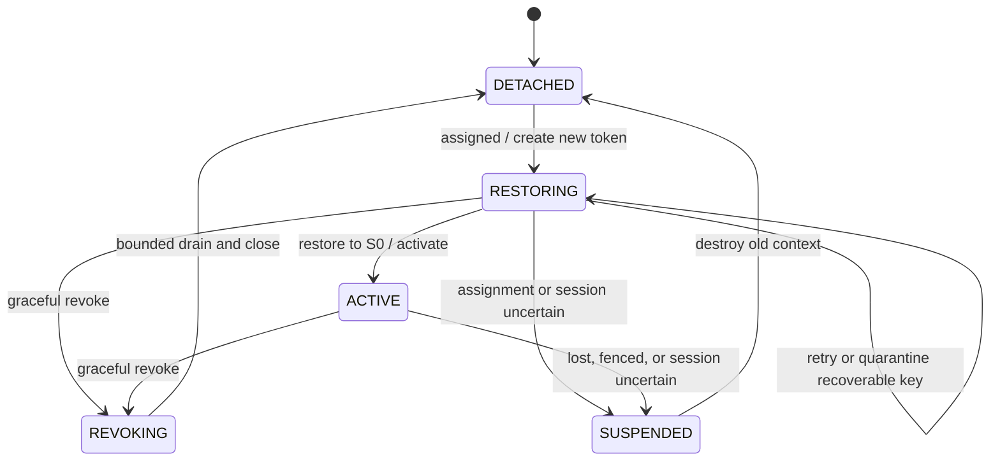
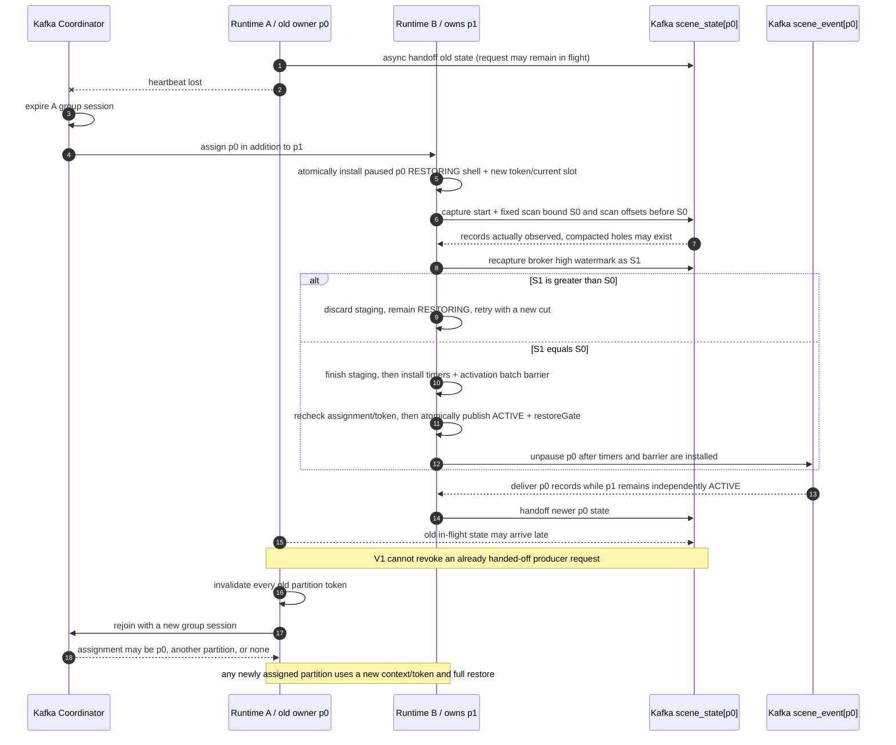

# Scene Runtime 调度、分片与故障转移

> **规范地位**：本文与[场景联动 Runtime 主规格总纲](场景联动%20Runtime%20主规格总纲.md)
> 共同组成 Scene Runtime 的规范性架构决策源。本文唯一拥有 partition ownership、Manager/Actor
> 执行、PartitionRuntimeContext 状态机、completion、restore、rebalance 与 Zombie 协议；主规格
> 唯一拥有产品边界、wire、业务状态/求值、Action Outbox 事务、route/hash、容量与总体取舍。
> 两者无“后写覆盖”关系；冲突必须在同一次变更中联合修订。
>
> **恢复 ADR：未冻结。** 本章定义待实施和验证的协议，不表示恢复 RTO、compaction 行为、
> Zombie 故障注入或容量证据已经通过。

<a id="runtime-scope"></a>

## 1. 范围、权威关系与不承诺项

本章只回答 Scene Runtime 如何获得、隔离、运行和交接 Kafka partition，以及该过程中
Manager、Actor lane、完成边界与恢复状态如何协作。规范责任按下表分工：

| 权威层级 | 唯一拥有的内容 |
| --- | --- |
| 本文拥有 | partition ownership、Manager/Actor 执行、PartitionRuntimeContext 状态机、completion、restore、rebalance 与 Zombie 协议 |
| 主规格拥有 | 产品边界、wire、Binding/SceneBindingState 业务语义、求值、Action Outbox 事务、route/hash、容量与总体取舍 |
| 从属契约拥有 | 只在两份架构源的边界内细化控制面/匹配、算子/身份以及 SLO/故障测试/实施，不得反向改写架构决策 |

V1 不承诺持久化 DB owner epoch 或 lease，不承诺 Kafka transaction/EOS，不承诺
跨 PG/Kafka store 原子性。`Actor` 也不承诺第三方 Actor framework、goroutine-per-Actor、
mailbox、remote protocol、supervision 或 Actor snapshot。Kafka partition 不固定到某台机器；
恢复 SLO/RTO 与 compaction 行为仍未冻结。

<a id="runtime-model"></a>

## 2. 一分钟模型与稳定身份

```text
Kafka Consumer Group
└─ scene_event TopicPartition
   └─ PartitionRuntimeContext[p]
      └─ Actor lane (tenantCode, evaluationSubjectKey)
         └─ SceneBindingState (tenantCode, bindingId, evaluationSubjectKey)
```

Coordinator 把 `scene_event` TopicPartition 分配给 Runtime 实例；它分配的不是 BindingState。
TopicPartition 是消费权、故障转移、state/timer ownership 与 completion 的单元，不是
Actor。每个 TopicPartition 对应一个进程内 context，用于封装该 partition 的本地生命周期与
所有权。其下可容纳大量以 `(tenantCode, evaluationSubjectKey)` 为键的串行 lane；每个 lane
又可持有多个互相独立、以 `(tenantCode, bindingId, evaluationSubjectKey)` 为业务键的状态。
下文将 schema 定义的 `SceneBindingState` 简称为 `BindingState`。

下列身份不可互换：

- `sceneTopicGeneration` 识别 Topic 扩容 cutover 世代，它不是 Consumer Group generation。
- Consumer Group session 是当前 consumer 与 Coordinator 的会话身份，不进入业务 identity。
- `localPartitionGenerationToken` 只识别一次本地 partition activation，是进程内的瞬态能力标识。
- Actor key 是 `(tenantCode, evaluationSubjectKey)`，它只定义一条 subject-keyed serial lane。
- BindingState key 是 `(tenantCode, bindingId, evaluationSubjectKey)`，它标识单个 Binding 的业务状态。
- `transitionId/effectId` 是跨重试稳定的逻辑 transition/action 身份，不是所有权令牌。
- `timerFireId` 识别同一轮 timer 到期，它不代表 lane、state 键或 partition 世代。

<a id="runtime-components"></a>

## 3. Manager、PartitionRuntimeContext、Actor lane 与 BindingState

- Coordinator 只分配 TopicPartition，不分配 BindingState；具体 state 由 route/hash 所在 partition
  的当前 owner 承载。
- `PartitionRuntimeContext[p]` 只拥有 partition `p` 的 lifecycle/token、restore gate/boundary、
  completion sequencer、Actor/timer index 与 in-flight reverse index，不得枚举或关闭其他 partition 的对象。
- SOURCE_DELTA 与 source-side `SubjectLifecycle` record 先进入
  `(tenantCode, sourceSubjectKey)` 串行 lane。Manager 在该 lane 内处理 SOURCE_DELTA 时先验证
  ProcessingContext，然后在同一个完整 ProjectIndex read view 中完成 matching 和 target
  bundle 聚合；SubjectLifecycle 的 SubjectContext/version/fanout 也在该 source lane 内按输入顺序
  执行。终端 input 不重复 reverse matching。Manager 只是
  Scene Runtime 内部组件，既不是第三套 Runtime，也不是 durable owner。
- Actor lane 串行化同一 subject key 的 source-side expansion 与 evaluation-side event/timer callback；
  当 `sourceSubjectKey == evaluationSubjectKey` 时，source lane 与 evaluation-subject lane 是当前同 key lane，
  不是两个可并发的队列。一条 lane 可持有多个
  相互独立的 BindingState。实现可使用共享 worker pool、keyed executor 或分片队列，但不得因
  Actor 一词推导出独立 goroutine、mailbox、remote、supervision、snapshot 或框架承诺。
- BindingState 是 schema 定义的业务状态，不是 Go 对象快照。只有按主规格 schema 规范序列化的
  value 可进入 `scene_state`；Actor 引用、锁、mailbox、编译产物和 timer handle 均不进入。

<a id="runtime-partition-isolation"></a>

## 4. 同一 Runtime 的多 partition 隔离

| 进程内可共享 | 必须按 TopicPartition 隔离 |
| --- | --- |
| ProjectIndex、编译产物 | status、token、group session relation |
| worker pool、scheduler implementation | restore boundary/gate、completion sequencer |
| Kafka Producer、PG pool | Actor/BindingState、timer、in-flight reverse index |
| serializer、script runtime | input position、partition-local SubjectContext cache |
| process quota/metrics exporter | revoke/close/activation scope |

`group session relation` 表示该 TopicPartition 与当前 Consumer Group session 的归属关联，不是业务 state 或持久身份。

Runtime B 同时拥有 `p0` 与 `p1` 只表示一个进程承载两份独立 ownership：两者的 token、
status、restore、completion、Actor/timer、in-flight 与 SubjectContext 不得合并。revoke `p0`
必须仅失效并关闭 `p0` 的 context，不得关闭、暂停或清理仍属于 Runtime B 的 `p1`。

即使 source 与 target partition 当前都在 Runtime B，跨实体 target 仍必须写为终端
`LINKED_DELTA`，通过 Kafka 按 target key 进入目标 partition。只有
`sourceSubjectKey == evaluationSubjectKey` 时允许本地直递；此时 source 与 target 天然使用同一
route key，不得把“同进程”扩展为跨 partition 快捷路径。

<a id="runtime-normal-completion"></a>

## 5. 正常调度与完成边界

每个 input 先进入对应 PartitionRuntimeContext，再按 input kind 形成或验证完整 target bundle，
并共享以下 1～8 步调度、求值和完成顺序。本章只拥有 lane/routing 执行顺序；
matching、SubjectContext 与 lifecycle version 的业务算法仍由主规格拥有，此处不复制：

> barrier retry 对 poll / heartbeat、Actor lane、partition completion 和其他 partition 的影响，见
> [《水线与读取屏障详解》§6](水线与读取屏障详解.md#retry-kafka)；以下条款仍是调度行为的唯一规范来源。

1. record 进入与其 topic/partition 匹配的 PartitionRuntimeContext，并携带 topic、partition、
   offset 以及入口处捕获的 token。
2. SOURCE_DELTA 与 source-side SubjectLifecycle record 必须先进入
   `(tenantCode, sourceSubjectKey)` 串行 lane；Manager matching、SubjectContext 读取/更新、version 检查和
   fanout 在该 lane 内按输入顺序执行。若首条输入因 index/context lookup、retry 或 fanout
   阻塞，同 source 的后续输入不得越过；只有不同 subject key 的 lane 可并发。
   只有 SOURCE_DELTA 读取 reverse-dependency，在上述 source lane 中完成 matching 与 bundle 聚合；
   LinkedDelta、LifecycleTargetDelta、ScheduleEvaluate 等终端 handler 只验证已携带的完整 target bundle，
   不重新 reverse matching，也不从终端 Linked 再生成 Linked。
3. SOURCE-side 形成的 same-subject target 可在当前同 key lane 继续求值，不得离开该 lane
   另开并发捷径；SOURCE-side cross-subject target 只能发终端 Kafka bundle，经 Kafka 按
   target key 路由到目标 partition。LinkedDelta、LifecycleTargetDelta、ScheduleEvaluate 等
   terminal input 已在目标 partition，必须直接进入 payload 已选定的 evaluation-subject lane，
   不先进 source lane，不按原 source key 再次路由。
4. lane 串行应用一个完整 bundle，并保证每个 Binding 最多求值一次。
5. 任何会推进 state 的分支都先规范序列化和验证 tentative state，包括点数、timer state
   与 32 KiB 配额；失败时不写 Outbox、不发布内存状态、不注册或取消 timer handle，
   也不发送 state。
6. 只有动作分支才在一个 PG 本地事务内插入本轮全部 Action Outbox rows；无动作的 state/FSM
   更新跳过 PG。Outbox 事务的唯一定义见主规格 §12.3；本章不重建 DDL 或身份公式。
7. 验证成功，并且对于动作分支仅当 PG commit 成功后，才发布内存 state 并注册/取消
   timer；存在 state 变化时，对已验证的完整 `scene_state` 执行一次有界 best-effort
   producer handoff attempt。
8. partition 的 completion sequencer 只在完整 completion 谓词成立时，按顺序推进连续的
   next-offset；较晚完成的 input 不得越过较早未完成的 input。

一个 input 只有同时满足下列完整谓词才算完成：

- 全部候选已完成求值，或已完成获批准的最终失败处置。
- 实际产生的 Action Outbox 已 commit，或 Outbox 失败经过规定重试后，已完成 quarantine
  或获批准的最终失败处置。
- Actor 内存 state/timer 已按上述先后顺序发布；本轮无状态或 timer 变化时该项按不适用满足。
- SOURCE、Linked、LifecycleTarget 等全部非 state data-event pack 已完成 callback 与有界 retry，
  或在耗尽后完成 quarantine/获批准的最终失败处置。
- 存在 state 变化时，`scene_state` 已规范序列化并完成一次有界 producer handoff attempt：
  立即拒绝需被记录；producer 接受后不等待 broker ACK/callback，后续异步失败不反向阻塞
  input offset。无 state 变化或 no-op 时该条件按不适用满足，不强制发送 state。
- 只有连续的 earlier next-offset 全部完成，才能提交当前 next-offset。

该 completion 不表示 Webhook、通知或 DeviceCommand 已被外部系统执行，也不表示 state、
Action Outbox 与 input offset 之间存在 PG/Kafka 原子性。

每个 `PartitionRuntimeContext` 还必须拥有只属于该 TopicPartition/activation generation 的
`offsetCommitPipeline`。普通 normal commit 在该管线中必须严格串行并且 single-flight：
同一 partition 同一时刻最多一个 commit request in-flight，后续请求只能在前一请求
进入 ACK 或失败终态后才可 admission/发送。`last-known committed floor` 只能在 broker
ACK 后按该 request 的 context/generation 条件推进；仅发送、超时、未决或失败都不得
推进 floor。这是 offset request 的本地顺序契约，不是 broker 所有权 fence 或 EOS。

每一次 timer callback 注册（包括 restore 重建 timer handle）都捕获注册当时 current
`{TopicPartition, token}`；恢复时不得复用原 timer slot 创建时的旧 token。到期后，callback 必须使用
该次注册所捕获的 token，并回到当前 `(tenantCode, evaluationSubjectKey)` lane 串行处理。
current Binding、current-slot 以及稳定业务身份的计算和验证仍由主规格及算子语义拥有，
本章只冻结 callback 的 partition 归属与回 lane 调度边界。

<a id="runtime-state-machine"></a>

## 6. PartitionRuntimeContext 状态机

`PartitionRuntimeContext` 是 Scene Runtime 的进程内实现抽象，不是 wire contract、持久化 schema
或可跨进程传递的所有权证明。它精确包含以下概念：

```text
PartitionRuntimeContext {
  sceneTopicGeneration
  topicPartition
  status
  localPartitionGenerationToken
  restoreBoundary / restoreGate
  completionSequencer
  offsetCommitPipeline
  actorIndex / timerIndex / inFlightIndex
  groupSessionToken
}
```

`restoreBoundary` 与 `restoreGate` 是每个 context 中同时存在的独立概念：前者只固定一次
restore attempt 的 scan upper bound，不是严格 point-in-time state view；后者控制普通
dispatch 的可见性。概念块中的 `/` 不表示二选一。

同一 TopicPartition 的全部 activation generation 共享一个进程内
per-partition lifecycle linearization domain。实现可以是短临界区/lock，也可以是等价的
CAS 或串行命令协议；它不是新的 wire/schema 字段，也不是持久 fence。下列动作必须
进入该 domain，共享一个
线性化顺序：revoke/lost/assigned transition、current-slot/token 变更、timer callback routing、
activationQueue splice、staged registry 与 `ACTIVE`/restoreGate 发布、Kafka pause/resume、completion
frontier freeze、normal-commit admission 关闭、revoke final-commit admission 及其 context/generation 校验，
以及 lost 的 no-commit
决定。
这里的 Kafka pause/resume 是 consumer 本地 fetch-dispatch 状态变更或对等串行命令的登记，
不是 broker I/O。

该 domain 内只允许有界的 pointer/CAS、状态变更、本地 pause/resume 与 O(1)/bounded batch
registration；临界区内不得执行 I/O、完整 restore、长时间 drain 或大批逐条业务处理。
完整 restore 和 batch 的展开/drain 在 domain 外执行；若 client adapter 不能提供有界的本地
pause/resume，必须改用等价的串行命令协议，并在命令应用点重验 generation 条件。
唯一允许的有界 network I/O 例外是 §8.1 的 revoke-final-commit：commit admission 与 frontier
freeze 仍在 domain 内完成，实际网络调用必须先释放 lifecycle lock，且只能在 revoke callback
返回前执行。该例外不允许把完整 drain、restore 或 Actor rebuild 搬进 callback。

`localPartitionGenerationToken` 是每次 assignment 在本进程新建的临时 fencing token。普通数据面效果的
唯一入口门是：

```text
NormalEffectGate =
  capturedToken == currentToken
  && partitionStatus == ACTIVE
  && partition 仍属于 current assignment
```

restore 期间唯一可用的维护效果门是：

```text
RestoreMaintenanceGate =
  RESTORING
  && capturedToken == currentToken
  && partition 仍属于 current assignment
  && output 仅为坏 key 隔离或纯 tombstone
```

旧 task 只能使用它在入口或注册时捕获的 token，永远不得重读 current token，也不得借用
新 token 通过 gate。data-plane Manager 发起的工作和每个 state 的 timer 都归属目标
TopicPartition，并必须捕获该 partition 当时的 token；进程级 callback pool 只是执行资源，
不得绕过上述 gate。只有 `ACTIVE` 能通过 NormalEffectGate。

普通 data-plane task 的 NormalEffectGate 结果不得在 task admission 缓存为后续通行证。
每一个不可逆或可见副作用边界都必须使用该 task 原始 capturedToken 重新计算完整
NormalEffectGate，不得重读或借用 current token。逐边界重验至少覆盖：

- async continuation/callback 每次重入。
- PG transaction entry 与 Outbox insert 入口。
- Linked/state Producer handoff。
- 内存 state/timer publication。
- timer register/cancel。

restore 维护效果在每个隔离或纯 tombstone 输出边界也必须以原 capturedToken 重验
RestoreMaintenanceGate。已进入 PG 或已 handoff 给 Producer 的请求无法撤回；gate 后续失败只能
阻止尚未进入的副作用，这个窗口仍属于 §9 风险，不是 durable fence 或 EOS 承诺。



上图的 `DETACHED`、`RESTORING`、`ACTIVE`、`REVOKING` 和 `SUSPENDED` 是本章冻结的全部
PartitionRuntimeContext 状态。进入 `REVOKING` 或 `SUSPENDED` 时必须先使 token 失效，
再 drain、rejoin 或 cleanup；失效后的工作不可以因清理还在进行就继续产生效果。

`RESTORING` 中收到 graceful revoke 时也只沿 `RESTORING → REVOKING`：必须在 lifecycle
linearization domain 内先 invalidate current token，再进入 `REVOKING` 并 pause；
丢弃该 generation 的 staging 与尚未发布的 activation queue/timer descriptors，并且只做
generation-conditional cleanup，不得删除或关闭其他 generation 的 current slot/资源；同 Runtime
仍为 `ACTIVE` 的
`p1` 不受影响。RESTORING 的 graceful revoke 不得转入 `SUSPENDED`；后者只用于
ownership/session uncertain、lost 或 fenced。

由于该 partition 的普通 `scene_event` 尚未开放，RESTORING revoke 通常没有新的 event frontier。
只有按 §8.1 已冻结、`frontier >= last-known committed floor` 且属于该 context/generation 的
eligible frontier，才可在 revoke callback 返回前至多一次 final commit；否则 skip final commit。
失败或超时仍接受从既有 committed offset 重放，callback 外不得 commit。

该状态图按单次 activation generation 解释。quick rejoin 时，old `REVOKING`/`SUSPENDED`
context 的 cleanup 可与 new `RESTORING` context 短暂重叠，但 old token 已先失效，current registry
slot 由 new context 原子替换。old cleanup 只能关闭自己的 actorIndex、timerIndex 和
inFlightIndex；移除 registry slot 必须以 `{oldContext, oldToken}` 做条件 CAS/remove。如果实现
不使用 CAS，必须提供等价的 generation-conditional remove；条件失配就什么也不删，
绝不得删除或关闭 new slot 及其资源。full cleanup 仍在 callback 外执行，不得为它阻塞
callback 返回。

竞态结果由上述线性化顺序决定：若 lost 先赢，它先使 old token 失效并 pause，old
activation 不得发布或 resume；若 activation 先赢，它的 batch 登记、发布和有条件 resume
先线性化，lost 随后使 token 失效并 pause。quick rejoin 安装 new `RESTORING` shell 后，
不存在 domain 外的 stale resume 可以覆盖 new pause。

franz-go callback 与状态转移的映射如下：

- `OnPartitionsRevoked(p)` 无论 current status 是 `ACTIVE` 还是 `RESTORING`，都必须在 lifecycle
  linearization domain 内先使 token 失效，再使受影响 partition 进入 `REVOKING` 并 pause；token
  失效是该短线性化动作的第一步。同一短临界区还要
  freeze 已完成且安全连续的 next-offset frontier、last-known committed floor，以及只属于该
  context/generation 的 final-commit admission。释放 lifecycle lock 后依 §8.1 完成 callback 内
  唯一一次有界 final commit。
- `OnPartitionsLost`、group-session cancellation、member/generation fencing，以及 consumer
  close/recreate 也必须在同一 domain 内先使 token 失效，再进入 `SUSPENDED` 并 pause；
  **OnPartitionsLost 绝不提交 offset**，其 no-commit 决定与状态切换一起线性化。
- `OnPartitionsAssigned(p)` callback 必须立即在同一 domain 内新建 token 与 paused RESTORING shell，
  将 `{context, token}` 原子安装到 current registry slot，pause 受影响 partition 的普通
  dispatch，登记 async restore 后返回。该 callback 不等待 config；自动 rejoin 不得沿用旧 token。
- `RESTORING` 期间 Consumer Group 仍继续 poll/heartbeat，只 pause 受影响 partition 的普通
  dispatch，不影响其他 `ACTIVE` partition。
- 除 §8.1 的 revoke-final-commit 外，callback 内只做原子状态/token 切换、pause 和工作登记；
  normal assigned/lost callback 仍须快返，lost 不执行 commit I/O。完整 drain、restore 与 Actor
  rebuild 在 callback 外执行，而且不得阻塞任何 Consumer Group 协调循环；revoke
  callback 加其 final commit 的总时长必须受 rebalance budget 约束。
- callback adapter 提供 happens-before：revoke/lost 的 token 失效完成必须先于后续 `OnPartitionsAssigned`；
  后续 assignment 无论是自动 rejoin 还是 consumer 重建，都不得沿用旧 token。

assignment admission 与 callback 外 async worker 构成一个两阶段协议：第一阶段只原子安装
paused RESTORING shell、new token/current slot 并登记工作；第二阶段始终在该 shell 和
token 下等待 full config cache/ProjectIndex ready，再捕获 restore cut。因此不存在长时间
config wait 期间无 context 或无 gate 的窗口。

单次普通 broker request 失败本身不能证明 ownership 已丢失，不得仅凭该信号虚构一个
持久 fence 或 EOS 保证。从实际丢失 ownership 到本地 callback 完成 token 失效之间仍可能
存在 observation gap；该窗口是 best-effort 风险，不是成功证据。

<a id="runtime-restore"></a>

## 7. Assignment 与 state-before-event restore

一次 assignment 的 restore 是 callback admission 加 async restore 的两阶段协议，必须把下列 1～8 步
作为一个不可拆分的激活算法。第 1～7 步与第 8 步的发布前复验共同构成
activation construction；它全部完成前不得对该 partition 宣告 `ACTIVE`。construction
完成后，第 8 步只能在其明确定义的 atomic visibility point 发布：

1. callback admission 必须立即新建 token 和 paused RESTORING shell，原子安装 current registry
   slot，pause 该 partition 的普通 dispatch，登记 async restore 后返回。
2. callback 外 worker 在该 shell/token 下等待完整 config cache 与 ProjectIndex ready；等待期间
   shell 仍为 `RESTORING`、restoreGate 仍关闭。ready 后先复验 shell 仍是 current slot、token
   仍有效且 partition 仍属于 current assignment；失配就终止该 worker，不捕获 cut。
3. V1 `scene_state` 为 nontransactional compacted topic。本步在开始时作一次固定观察，同时捕获
   `start = captured log-start` 与 `S0 = restore consumer 观察到的 broker high watermark`；该 S0
   是 consumer-visible next-offset frontier，不是 leader LEO，也不随之后 broker high watermark 增长而移动。
   S0 只是该 attempt 的固定 scan upper bound，**不是严格 point-in-time state view**，
   也不证明 compacted log 仍保留了该上界前曾经写入的每个 record。本定义不引入
   read_committed/LSO 未来方案承诺。从 start 按 offset 升序扫描，只应用本次扫描
   **实际观察到的** `offset < S0` record；不得为 offset hole 或未观察到的 key
   猜测 value、tombstone 或时间点快照。
   fetch/batch 中 `offset >= S0` 的 record 必须 buffer，或对本轮 restore 明确 ignore，不得进入
   staging。当 scan frontier/consumer position 已达到或越过 `S0` 就终止扫描，不要求
   next-offset 恰好等于 `S0`，以容忍 compaction 造成的 offset hole 与 batch crossing。
4. 对所有实际观察到的 `offset < S0` record 按 offset 升序 replay，对每个 raw state key 只保留
   latest-offset outcome：通过 current BindingCtx 验证的 valid value 替换该 key 的旧 staging；
   input tombstone 删除该 key 的旧 staging，并将最新结果标为缺失。同 key 的最新结果若是
   坏 value、坏 key，或 Binding 已删除、disabled、incompatible，必须清除并遮蔽更旧
   staged value，进入隔离/缺失冷启动语义，不得回退复活旧 state 或 timer。对无法解析
   business key 的坏 key，至少使用 raw key bytes shadow 同 bytes 的更旧 outcome，且不得为它
   构造 Actor。隔离或纯 maintenance tombstone 是 restore 外部效果，仍只能经
   RestoreMaintenanceGate 发出。
5. 在 staging 中构造 Actor 的 transient state，但只收集 timer descriptor，不注册、取消或执行
   timer。对任何 membership-dependent set 标记 `scopeReconcileRequired`，在 current-scope
   reconciliation 完成前保持零效果。
6. scan frontier/consumer position 达到或越过 `S0` 时重新检查 assignment 与 token，
   并重新捕获该 partition 的 broker high watermark 为 `S1`。assignment/token 已变更时，
   丢弃完整 staging 和 context，用新 assignment/token 重启。即使 ownership 未变，
   只要 `S1 > S0`，就说明 cut 后存在 append，其中任一 append 都可能在扫描前或扫描中
   触发 compaction 并改变 `< S0` 的可见 record 集；必须丢弃 staging，保持
   `RESTORING`，从当时重新捕获的 log-start 并以新 cut 开始新 attempt。重试次数与
   总 restore RTO 必须有界；耗尽时仍不得进入 `ACTIVE`，必须告警并转人工处置，
   不得用缺失记录或推测快照绕过。只有 `S1 == S0` 才允许该 attempt 继续激活。
7. 保持 `RESTORING`，完成 staged Actor/state registry，安装所有 future timer handle，并从已到期
   descriptor 构造进程内 activation queue。future timer 安装后若在 ACTIVE 可见点前到期，
   其 callback 必须进入同一进程内 activation queue；发布前只入 queue，不执行业务 timer，
   也不尝试通过 NormalEffectGate，更不得因 gate 尚未打开就作为 no-op 丢失。每次 handle
   install 都以 shell 捕获的 token 重验 current slot/token/assignment；这是不可见的 activation
   内部资源准备，不是普通业务 timer 副作用。该 queue 的 non-droppable 仅承诺在 live context 和
   activation critical section 内成立，它不是 durable queue；进程死亡后依靠 fresh restore 重建。
   每个 timer callback 在决定入 activation queue、direct route 或 no-op 前，都必须进入同一
   lifecycle linearization domain。
8. 在 lifecycle linearization domain 的短临界区内做最后一次 context/token/assignment
   复验，然后先把 activationQueue 作为一个有序 batch 原子 splice/登记到 partition lane
   scheduler，建立 activationQueue batch barrier。该 O(1)/bounded registration 只登记一个在发布点
   之前不可执行的 batch descriptor；不在临界区内展开逐条 timer。随后把 staged
   Actor/state registry 发布、`status = ACTIVE` 与 restoreGate release 组成唯一的 atomic
   visibility point。在该点之前 NormalEffectGate 始终不可通过，所有 timer handle 已安装且
   任何普通 effect 都不得执行。只有当
   `currentSlot==shell && currentToken==capturedToken && status==ACTIVE && restoreGate open` 时才能
   resume/unpause `scene_event`；条件失败必须 no-op。batch barrier 登记必须先于 resume，也必须
   先于允许 direct timer callback 入 lane。退出短临界区后，scheduler 才在锁外 drain/展开
   batch；direct timer routing 只能登记为 barrier 之后的 work，不得越过该 batch barrier。
   staged registry 和 pre-publish activation 只是 `RESTORING` 的内部阶段，不在冻结的五态之外
   新增可见状态。

Kafka Topic 必须配置并持续验证 tombstone retention 的可执行前提：
`delete.retention.ms` 必须大于经 POC 签字的最坏 full-scan attempt 时长加运维安全余量，
且 bounded retries 的总 RTO 不得让任一 attempt 超过该窗口。Runtime 只能应用扫描实际看到的
tombstone，不得为已被 compaction 清除、未取得或根本不存在的 tombstone 虚构证据。
若 broker 配置、scan 性能或当前 compaction 条件不能满足这一可执行保障，该 partition
必须 fail closed 保持 `RESTORING`，不得激活。

成功 attempt 只证明对一个固定上界完成了有界扫描，不证明 point-in-time state 快照。
在最后一次 `S1 == S0` 复验之后到 `ACTIVE` 原子发布之间仍可能出现 late append；
该 record（包括旧 owner 晚到的 state）不会拉入当前 staging，明确保留为 §9 的
best-effort 窗口。不同 partition 可独立
restore；正在 restore 的 `p0` 不得暂停、清理或使已是 `ACTIVE` 的 `p1` 失效。

`RESTORING` 期间禁止普通求值、非 tombstone state、Linked、Outbox 和业务 timer 推进；
唯一允许的效果是通过 RestoreMaintenanceGate 的坏 key 隔离或纯 tombstone。任何其他
output 都必须等到 activation 完成，并重新通过 NormalEffectGate。

<a id="runtime-failover"></a>

## 8. Graceful revoke、硬故障与 Zombie

### 8.1 Graceful revoke

收到 partition 的 graceful revoke 时，Runtime 必须先在该 partition 共享的 lifecycle
linearization domain 内使 current token 失效，再进入 `REVOKING` 并 pause；随后在同一个短临界区
关闭该 context/generation 的 normal-commit admission，使 completion 之后不能再向 pipeline 加入普通 commit，
冻结该 context/generation 已完成且安全连续的 next-offset frontier 及 last-known committed floor，
并记录 generation-conditional commit admission。此后不再接纳该 partition 的新 record，所有尚未
进入副作用边界的工作也因 NormalEffectGate 失败而停止；不能先 drain 再失效 token，也不能用
revoke callback 的到达时间冒充持久 owner fence。

释放 lifecycle lock 后，必须在 `OnPartitionsRevoked` callback 剩余 budget 内先等待该 pipeline
已存在的较低 normal commit 进入终态。只有该较低 commit 已 ACK、committed floor
已条件推进，且确认没有该 context/generation 的旧 commit in-flight 时，才允许在同一
`offsetCommitPipeline` 内对 revoked partition 发送 **至多一次 bounded blocking final commit**。
若较低 normal commit 在 budget 内仍未决、失败或超时，必须 skip final commit 并接受从已知
committed offset 重放；callback 外不得重试 normal/final commit。该顺序保证不会出现
较低 normal commit 在较高 final commit 之后才落到 broker 的回退窗口。
这里的 skip final 只是不再发高 offset，**不撤回、不取消**已经发送的 normal request。
该 request 若已被 Coordinator 接受并应用，其群组线性化顺序必须早于新 assignment；
若新 generation 已生效，携带旧 generation 的 commit 必须被 Consumer Group 世代校验拒绝。
迟到 ACK/错误响应只是对这两种结果的迟到观测，不得重开已关闭 context 的 admission
或改写新 generation 的 committed floor；该事实边界不是 durable fence。

final 提交值只能是该 partition completion sequencer 在冻结点接纳的 safe contiguous
next-offset；它必须不小于等待 ACK 后的 last-known committed floor，并且 commit admission
仍明确属于被 revoke 的 context/generation。没有合格 frozen frontier 就不提交；后完成的 offset、
未满足完整 completion 谓词的 offset 或其他 partition 的 position 均不得夹带提交。失败或超时后
**callback 外不得重试 final commit**，系统接受从既有 committed offset 重放；callback 与这一次
commit 的合计耗时必须在 rebalance budget 内。这是 callback 唯一允许的有界 network I/O 例外，
不扩展为持久 owner fence。**OnPartitionsLost 绝不提交 offset**。

关闭范围只包含被 revoke generation 自己的 Actor、timer、in-flight 与 completion context；其
callback 返回后的 per-partition bounded drain 只做资源收尾和 generation-conditional cleanup，
绝不再推进该 generation 的 offset；close/remove 完成后才进入 `DETACHED`，不得清理仍属本
Runtime 的其他 partition。revoke 的 token invalidation、pause、frontier freeze、commit admission
与 current-slot 变更和 §7 activation 使用同一个 lifecycle linearization domain；旧 activation 的
conditional resume 若发现 slot/token/status/gate 条件失配必须 no-op，因此 stale activation 不能在
revoke 或新 `RESTORING` shell 之后恢复 dispatch。完整 drain、restore 与 Actor rebuild 都不得借
final-commit 例外阻塞 Consumer Group 协调循环。

### 8.2 原 Runtime 硬故障

原 owner Runtime A 心跳中断时，Kafka Coordinator 按 Consumer Group 协议过期 A 的 session，
并把失去的 partition 分配给它选择的存活 member，例如已拥有 `p1` 的 Runtime B。B 收到 `p0`
assignment 后立即安装新的 paused `RESTORING` context/token，并按 §7 完整恢复。B 的恢复不等待
A 进程 cleanup，也不等待 A 收到 revoke/lost callback；A 是否仍在运行不构成 B 激活的前置条件。



图中 B 对 `p0` 的 restore 与 `p1` 的运行相互隔离；A 的晚到 state 则落入 §9 的残余窗口，
不能作为阻止 B 接管的理由。

### 8.3 Zombie Runtime 重连

Zombie Runtime A 一旦重新获得协调能力，必须先使进程内所有旧 partition token 失效，销毁旧
generation 的可见执行资格，然后以 **new group session** 重新加入 Consumer Group。A 只能接收
Coordinator 此次选择的 assignment：可能是 `p0`、其他 partition，也可能为空；A 不会因为曾经
拥有 `p0` 就自动拿回 `p0`，B 也不向 A 传递 Actor 内存。

即使 Coordinator 再次把同一个 partition 分给 A，A 也必须创建 new token/new context，并执行
一次 full restore；禁止恢复旧内存、旧 timer handle、旧 completion frontier 或旧 token。所有
旧 callback 继续携带旧 token，在新的 effect gate 上必须失败。

<a id="runtime-best-effort"></a>

## 9. Best-effort fencing、幂等与残余窗口

本章的本地 token 与 effect gate 在 ownership 不确定时 fail closed，但它们不是跨进程可查询的
持久 owner authority。V1 的 fencing 是 **best-effort**：缩小并观测旧 owner 产生新效果的窗口，
不把本地状态机提升为 durable fence、lease 或 Kafka EOS。

| 对象 | 收敛手段 | 不承诺 |
| --- | --- | --- |
| Action | 相同 logical trigger/transition/action 派生稳定 `transitionId/effectId`；Action Outbox 的唯一键与下游幂等吸收相同逻辑动作的重放 | 不承诺 PG 事务入口前后的 owner 原子切换，不承诺外部系统 exactly-once，也不撤销已 commit/accepted 的动作 |
| Timer | timer 注册捕获 partition token；callback 回 current lane，并校验 current Binding/current slot；同一轮 fire 以稳定 `timerFireId` 参与 action identity | 不承诺内存 timer durable、一次且仅一次触发，或跨故障保留旧 handle；fresh restore 依据 state 重建 |
| Linked | producer handoff 前重验 gate；非 state data-event pack 依主规格的 callback、有界 retry 与 quarantine 处理，目标端再按业务 guard 求值 | 不承诺 Kafka/offset 跨 Topic 原子性；最终失败策略接受的 Linked 丢失窗口仍存在 |
| `scene_state` | 发送规范化完整 value；恢复在固定 `[start,S0)` 内按 key 选择 latest-offset outcome，后续合法完整 state 可覆盖旧值 | 不承诺 producer handoff 可撤回、owner 顺序、broker ACK 纳入 completion，或旧 owner 晚到 append 不成为 **compacted latest** |

> A stable `effectId` absorbs a repeated logical action. An old `scene_state` append that becomes the compacted latest can roll business state backward and cause a different future transition; that is not the same logical effect and is not proven safe by idempotency.

另一个独立窗口是 **stale compacted-latest/reset resurrection**：disable、scope-exit、显式 reinit 或不兼容 reset
关闭内存 state/timer 后，如果 async tombstone Producer handoff 被立即拒绝，或 Producer 接手后的
best-effort delivery 失败，compacted Topic 仍可能保留该 state key 的旧 latest value。

若同一 state key 随后以 enabled 且兼容 semanticHash 重新适用，并在成功 next-live bootstrap 或新
state 覆盖旧值之前发生 rebalance，新 owner 可能从 compacted Topic 恢复旧 state 与 ARMED timer。
current enabled + semanticHash 只能证明当前配置允许加载兼容 state，不能证明 reset 已持久发生。

V1 不保证 next-live bootstrap 跨过该窗口，`effectId` 不能证明该窗口安全；旧 state/timer 复活后
产生的是不同的未来 transition，不是同一 logical action 的重试。
V1 不新增 reset watermark、durable tombstone 或 durable reset epoch/field/Topic。只能审计
tombstone 交付失败、显式 reinit/补发收敛，
并由 §11 与 SLO 故障注入量化；若风险预算为 0，必须由未来 ADR 提高持久 reset 门槛，不能把当前
best-effort 路径描述为 reset 已持久完成。

下列窗口已经越过本地可撤回边界，必须显式计量而不能包装成 fencing 成功：

- ownership 已在 Coordinator 侧丢失、但本地尚未观察到 callback/session cancellation；
- Kafka Producer 已经接受并持有的请求，包括尚未返回的旧 owner `scene_state` append；
- 已进入或已经 commit 的 PG transaction；
- 已被下游接受的 command、Webhook、notification 或其他外部效果。

NormalEffectGate/RestoreMaintenanceGate 只能阻止尚未进入相应边界的效果；边界已经进入后，后续
gate 失败不能撤回它。故 V1 不承诺 durable fence、distributed lease、DB owner epoch、Kafka
transaction/EOS 或跨 PG/Kafka 的原子 owner handoff。残余 state overwrite 可能改变未来 transition，
必须由 §11 的故障注入和恢复 ADR 判定是否可接受，不能用 `effectId` 幂等证明其安全。

<a id="runtime-partition-routing"></a>

## 10. 固定 partition、动态分配与扩容引用

route bytes/hash、V1 固定 partition count、`scene_event`/`scene_state` co-partition 约束以及 Topic
generation cutover 的唯一算法与流程继续由[主规格 §14](场景联动%20Runtime%20主规格总纲.md)
拥有；本章不复制 hash、key 编码或扩容步骤。固定的是一个 Topic generation 的 partition 数与
route 规则，不是机器归属。partition 始终由 Consumer Group 动态分配，绝不 machine-pinned。

客户端与 group 策略原样继承
[Kafka 规格 §7.2](../4.1.Kafka/1.nats-to-kafka-greenfield-design.md)：
`franz-go v1.21.5 + classic group + cooperative-sticky`。这里不新增 client/version/protocol 决策，
也不把 cooperative assignment 解释成 owner lease。

故障转移示例固定读作：`A owns p0; B owns p1 → A fails → B also owns p0 → A rejoins`。B 接管
`p0` 时没有 B→A 的内存 handoff；B 的 `p1` 在 `p0` restore 期间保持独立 `ACTIVE`。A 重连后
可能得到 none、different partition 或 same partition，唯一依据是 Coordinator assignment；即使
得到 same partition，也必须使用新 context/token 做 full restore，不能续用故障前内存。

<a id="runtime-observability"></a>

## 11. 可观测性、故障注入与实施门槛

指标全集与验收编号分别以[主规格 §16、§19](场景联动%20Runtime%20主规格总纲.md)为准，
SLO、故障窗口、交付物与 rollout gate 以
[《SLO 故障测试与实施》§§5–8](SLO故障测试与实施.md)为准。本章只补充 runtime lifecycle
必须可重建的证据，至少包括：

- 每个 partition 的 status/token 变更，含 old/new generation、触发原因和 current-slot 结果；
- restore 每次 attempt 的 `start`、固定 `S0`、复验 `S1`、scan frontier/progress、
  records/bytes、duration、因 `S1 > S0` 重试/耗尽的原因与 tombstone-retention 前提检查结果；
- assignment/token 复验失败后的 discarded staging 数量、字节与原因；
- activation queue depth/age、activation batch barrier 登记/开放/drain 次序；
- per-partition completion gap、最早未完成 next-offset 与 safe contiguous frontier；
- per-partition/generation `offsetCommitPipeline` 的 normal admission 状态、in-flight request、
  ACK/failure/timeout 终态、committed floor 推进及 revoke 时 wait/skip-final 原因；
- revoke/lost/assigned callback 及 session cancellation 的次数、耗时和 partition 范围；
- effect gate rejection by reason，并区分 token、status、assignment、slot 与 restore gate；
- late state callback、arrival order 与 stale overwrite/compacted-latest evidence；
- reset tombstone handoff/交付结果、tombstone 交付失败、显式 reinit/补发收敛，以及 compatible
  re-enable/rebalance 后旧 state/ARMED timer resurrection evidence；
- `effectId` unique conflict、下游 dedup 与 duplicate external effect 收敛结果；
- 同进程 `p0`/`p1` 的独立 lag、restore、completion 与 ACTIVE progress；
- lifecycle-linearization 竞争结果，尤其 conditional-resume failure/no-op 与 stale resume prevented；
- activation batch barrier 前后 timer callback 的排队位置、direct routing 次序与 barrier violation。

故障注入必须覆盖 graceful revoke 的有界 drain、lost 无 callback 接管、Zombie late request、quick
rejoin、restore 在 `S0` 前后失去 assignment、future/due timer 穿越 activation visibility point、
conditional resume 失配，以及 `p0` restore 时 `p1` 持续推进。高基数 token/effect/state key 只进入
受控日志、trace 或审计，不作为无界 metric label。

必须固定注入 `failed reset tombstone → compatible re-enable → rebalance` fixture；
分别观察旧 state/timer 复活与动作幂等；动作由 `effectId` 收敛不能掩盖 reset resurrection，也不能替代
tombstone 失败、显式 reinit/补发及最终新 state 覆盖的因果证据。

**恢复 ADR 仍为“未冻结”。** 指标存在、dashboard 可见或 POC 跑完都不等于成功；只有禁止结果
断言、因果时间线、收敛终态与风险接受材料满足上述主规格/SLO 门槛，才能关闭 case 或冻结 ADR。

<a id="runtime-main-spec-index"></a>

## 12. 与主规格的职责索引

下表用于把读者的问题送到唯一算法源；它不把主规格的 transaction、wire 或业务细节搬到本文。

| 要决定的问题 | 唯一规范入口 | 本章的 runtime 补充边界 |
| --- | --- | --- |
| 端到端 data flow | 主规格 §4 | §§2–5 只说明 record 如何落入 partition context、Manager 与 Actor lane，以及何时 completion |
| `scene_event` wire、input kind 与 terminal bundle | 主规格 §5 | §§2、3、5 冻结 SOURCE matching 与 terminal routing 的执行分界，不重写 envelope/schema |
| Binding lifecycle、ProjectIndex 与 matching | 主规格 §6 | §§3、5、7 只规定 read view、assignment admission 与 restore ready gate |
| evaluation 业务语义 | 主规格 §7 | §§2、3、5 只提供 subject-keyed serial lane 与发布/完成顺序，不定义算子 |
| `scene_state` schema、key 与配额 | 主规格 §8 | §§3、5、7、9 规定内存归属、handoff completion、`[start,S0)` replay 与 stale append 风险 |
| state restore 的业务有效性与冷启动 | 主规格 §9 | §§6–9 唯一规定 context 五态、token/gate、activation 与 failover 协议 |
| timer 与 delayed action | 主规格 §10 | §§3、5–9 冻结 timer 的 partition/token 捕获、恢复安装、callback routing 与 revoke 边界 |
| Schedule 与 scope | 主规格 §11 | §§3–5、7、9 只约束 ScheduleEvaluate 的 terminal lane、state/timer ownership 与效果门 |
| Action Outbox 的稳定 `effectId` 与重复动作收敛 | 主规格 §12.2 | §§5、9 只引用稳定身份解释 rebalance 重放与 state rollback 的区别，不重写身份公式 |
| Action transition 完整 8 步顺序与 PG commit 失败处置 | 主规格 §12.3 | 唯一拥有 tentative state 规范序列化 → PG Action Outbox transaction/commit → 内存 state/timer 发布 → async `scene_state` Producer handoff 的先后顺序及 PG commit 失败处置；§§5、6 只重验 effect gate 并消费终态 |
| Producer callback/retry/quarantine、`scene_state` 交给 Producer 后的 best-effort delivery promise 与失败窗口 | 主规格 §13 | 唯一拥有 Producer 接手后的 ACK/retry/quarantine/final failure 窗口；§§5、9 只把交付终态作为 completion 或风险输入，不重写交付算法 |
| 完整 completion predicate、per-partition sequencer、安全连续 next-offset frontier、revoke final commit/handoff | 本章 §§5、8 | 主规格 §§12.3、13 提供 PG/交付终态，但不是这些 Runtime completion 与 offset 算法的第二真源 |
| route/hash、co-partition、固定 count 与扩容 | 主规格 §14 | §§4、7、8、10 规定动态 assignment、多 partition 隔离和每次 assignment full restore |
| 配额与 observability | 主规格 §16 | §11 补齐 lifecycle/token/restore/activation/completion 的 runtime 证据 |
| POC 与 ADR 冻结条件 | 主规格 §19 | §§9、11 给出 Zombie、late state、p0/p1 隔离与 conditional resume 的注入观察点 |

因此，数据流、wire、matching、evaluation、state、timer、Schedule/scope、transaction、delivery、
partition 与 evidence 都有且只有一个算法入口。交叉处固定拆成三块：① 主规格 §12.3 唯一拥有
完整 8 步顺序，即 tentative state 规范序列化 → PG Action Outbox transaction/commit → 内存
state/timer 发布 → async `scene_state` Producer handoff，以及 PG commit 失败处置；② 主规格 §13
唯一拥有 Producer callback/retry/quarantine、`scene_state` 交给 Producer 后的 best-effort delivery
promise（ACK/retry/quarantine/final failure 窗口）；③ 完整 completion predicate、per-partition
sequencer、安全连续 next-offset frontier、revoke final commit/handoff 唯一归本章 §§5、8。前两块
分别提供 PG 终态与交付终态，第三块据此裁定 input completion 与 offset；三者互不作为对方算法的
supplement 或第二真源。本文 §§2–11 不创建新 Topic、Group、schema、Actor framework 或持久
fencing 承诺。
